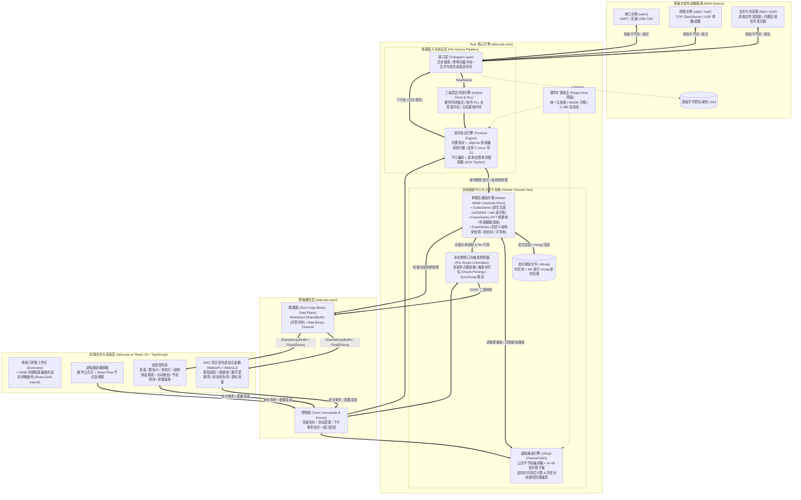

# DDScopeHost 系统总体架构设计

## 1. 项目定位与核心设计目标

**DDScopeHost** 是一款面向嵌入式开发、电机/电源控制、传感器采集与工业测控场景的超高速通用上位机软件。系统采用 **「Rust 核心引擎 + Tauri v2 跨端桥接 + React 19 & WebGPU 前端」** 架构，兼顾原生级超高速数据吞吐与现代前端灵活的拖拽式工作台生态。

### 核心架构基线指标
- **超高速吞吐**：核心链路支持单源或多源合计 **> 1M ~ 10M 点/秒** 的持续接入、解析、列式存储与虚拟通道计算，全程无全局锁阻塞。
- **多数据源并发融合**：同一工作区支持同时挂载多个物理/文件/仿真接口，各自绑定独立协议，汇聚至统一的命名空间全局通道树（如 `uart1/foc.iq`、`udp0/imu.acc_x`、`virtual/power`），支持跨源同屏比对与混合计算。
- **硬件示波器级混合信号体验（MSO）**：支持 **60 / 120 fps** 丝滑刷新、**多示波器独立触发锁存**（单示波器捕获故障毛刺时不影响其他视图继续监控）、模拟波形 + 数字逻辑时序带 + 状态机跳变色带同屏微秒级对齐、荧光余晖（Phosphor Grading）与 XY 模式。
- **双向全链路闭环**：支持高频调参「最新值覆盖合并直发（Fire-and-Forget Coalescing）」与关键控制指令「请求-应答事务跟踪（ACK / 超时重试 / UI 状态回显）」双模式。
- **核心与 UI 彻底解耦**：`ddscope-core` 为零 UI 依赖的纯 Rust 库，未来可直接复用于 CLI 工具、无头采集守护进程（Headless Daemon）或嵌入式远端代理。

---

## 2. 系统分层全景架构



---

## 3. 核心架构决策精要

### 3.1 多源并发融合与全局通道树
- 每个打开的数据源分配唯一 `source_id`（如 `uart1`, `udp_motor`, `replay0`），拥有独立的 `Transport` 任务与 `ProtocolCodec` 实例，互不阻塞。
- 所有物理通道按 `<source_id>/<channel_path>` 注册进全局 `ChannelHub`；虚拟通道统一挂载在 `virtual/<name>` 下，其输入可任意跨越多个 `source_id`。
- **三级混合时钟对齐**：
  1. **协议内嵌硬件时钟**：通过线性漂移/偏移估计器锚定至主机单调时钟轴（`host_mono_ns`），消除不同下位机晶振温漂。
  2. **高速无时钟采样流**：基于标称采样率或 **软件锁相环（Software PLL）** 动态跟踪包到达速率，将突发到达（USB/UDP 聚合包）的样本均匀展开到真实时间网格上，彻底消除阶梯状时间抖动。
  3. **低频异步报文**：直接采用主机单调接收时间戳。

### 3.2 突破 >1M 点/秒瓶颈的四级流水线
1. **原生位宽列式存储 + 多级 M4 金字塔**：数值按原始位宽（`i16`, `u16`, `i32`, `f32`, `f64`）分块紧凑存储，节省 50%~75% 内存带宽；写入时同步增量构建分支因子 `64` 的多级 **M4（Min, Max, First, Last）包络金字塔**。无论查看 100 微秒还是 1 小时（数亿点），每帧仅需提取约 `4 × 屏幕像素宽度` 个顶点，耗时 `< 0.1 ms`，且**数学上保证不漏任何单采样点毛刺**。
2. **纯内存环形配额 + `.ddcap` 流式 `mmap` 落盘**：默认在内存配额（如 `1~4 GB`）内循环复用；开启录制时将列式数据块与 M4 索引直接顺序刷入 `.ddcap` 文件，利用 `memmap2` 实现边录边回溯数小时超高速数据而不爆内存。
3. **跨端零拷贝二进制桥（`UiDataBridge`）**：Windows 下优先启用 `WebView2 SharedBuffer` 操作系统共享内存，跨平台兜底采用 Tauri v2 原生二进制通道（`InvokeResponseBody::Raw`），前端直接以 `Float32Array` 视图零拷贝上传 GPU。
4. **独立视口触发下沉 + 内存块钉住（Chunk Pinning）**：每个示波器实例在 Rust 端拥有独立触发器（含亚采样点线性内插消抖）。当某台示波器 `Single` 单次触发锁存异常波形时，自动持有对应时间窗口的 `Arc<Chunk>` 引用防止被环形缓冲区回收，同时后台采集与其他示波器/仪表盘照常实时刷新。

### 3.3 多模态通道形态（三类标准通道）
为统一支撑标量波形、自定义结构体、状态机与 FFT 频谱分析，全局通道抽象为三种正交形态：
- **`ScalarSeries`（标量时序流）**：原生数值与 `bool`，支撑模拟曲线、数字逻辑带及仪表控件。
- **`FrameSeries`（数组帧流）**：每个时间步对应一维数组（如实时 FFT 输出的 `1024` 点频谱帧、线阵传感器扫描帧），附带帧内轴量纲元数据。
- **`EventSeries`（结构体快照与字符串事件流）**：保存自定义结构体的完整树形快照（供结构体监视表绑定）、状态枚举跳变（供示波器 MSO 状态色带渲染）与日志流。同时结构体内的数值叶子字段会自动拆解（AoS -> SoA）映射为高速 `ScalarSeries` 子通道。

---

## 4. 技术选型清单

| 层级 | 模块 | 选定技术栈 / Crate | 选型理由 |
| :--- | :--- | :--- | :--- |
| **Rust 核心** | 异步与并行计算 | `tokio` + `crossbeam` + `rayon` | `tokio` 驱动多源异步 IO；无锁通道衔接协议解析；`rayon` 支撑虚拟通道并行 DSP 与历史分块回算 |
| **Rust 核心** | 接口与存储 | `tokio-serial`, `socket2`, `memmap2`, `bytes`, `bytemuck` | 支持高波特率串口、大容量 UDP 套接字、`.ddcap` 与超大原始文件 `mmap` 零拷贝映射 |
| **Rust 核心** | 信号处理与协议 | `rustfft`, `wide` (SIMD), `crc` | 高性能实时加窗 FFT、SIMD 向量化 M4 聚合与公式求值、全系列标准 CRC 硬件加速校验 |
| **桥接层** | 桌面宿主与类型同步 | **Tauri v2** + `specta` (`tauri-specta`) | 极小体积，支持 Raw Binary IPC 与 Windows `SharedBuffer`；`specta` 自动生成前端 TS 类型定义 |
| **前端 UI** | 基础框架与状态 | **React 19 + TypeScript + Zustand** | 生态最完备；控制面与面板配置用 Zustand 管理，60/120Hz 数据流绕过 React VDOM 直驱画布 |
| **前端 UI** | 停靠与拖拽画布 | **Dockview** + **React-Grid-Layout** | VS Code 级多窗口分屏停靠/悬浮 + 24/48 列细粒度自适应磁吸网格画布 |
| **前端 UI** | 虚拟通道编排 | **@xyflow/react (React Flow)** + 公式编辑器 | 可视化拖拽编排多进多出虚拟通道算子图 + 语法高亮的数学表达式输入栏 |
| **前端 UI** | 示波器渲染内核 | **WebGPU**（主）+ **WebGL2**（回退）+ Canvas 2D（标尺/游标层） | 硬件加速绘制百万包络顶点、MSO 逻辑/状态色带、荧光余晖帧缓冲衰减与 XY 点云 |

---

## 5. 仓库目录规划（Monorepo Workspace）

```text
DDScopeHost/
├── Cargo.toml                  # Rust Workspace 根配置
├── pnpm-workspace.yaml         # 前端 pnpm Workspace 配置
├── docs/                       # 架构设计与模块接口规范文档
├── crates/
│   ├── ddscope-core/           # 【纯核心库】零 UI 依赖
│   │   └── src/
│   │       ├── transport/      # 多源接口层：Serial, Tcp, Udp, RawFileReplay, SimGenerator, RawRecorder
│   │       ├── clock/          # 三级混合时钟锚定与软件 PLL 去抖动器
│   │       ├── protocol/       # 双向协议引擎：JustFloat, FireWater, Modbus, .ddproto 编译器, C-struct 导入器, ACK 事务器
│   │       ├── types/          # 原生标量类型、StructSchema、三类通道数据块定义
│   │       ├── storage/        # 原生位宽分块环形存储、M4 金字塔、Chunk Pinning、.ddcap 流式 mmap 引擎
│   │       ├── dag/            # 虚拟通道：公式字节码编译器、N->M 拓扑调度器、时间对齐器、历史回算器、内置 DSP 算子
│   │       ├── scope/          # 多实例示波器视口提取器、亚采样点触发器、SyncGroup 协调器
│   │       ├── plugin/         # 统一注册表与预留插件接口 (WASM / C-ABI)
│   │       └── workspace.rs    # 多源会话与全局通道中心顶层编排器 (CoreEngine)
│   ├── ddscope-plugin-api/     # 【预留】插件 SDK 稳定接口定义
│   └── ddscope-cli/            # 【可选】命令行无头录制、.ddcap 转换与压测基准工具
└── apps/
    ├── desktop/                # Tauri v2 桌面宿主 (src-tauri)
    │   └── src/
    │       ├── data_bridge/    # SharedBuffer / Raw Binary Channel 帧推送器
    │       └── commands/       # 控制面 Tauri Commands (自动导出 TS 绑定)
    └── web-ui/                 # React 19 + TypeScript 前端工程
        └── src/
            ├── bridge/         # DDSF 二进制帧零拷贝视图解析与高频订阅分发器
            ├── scope-engine/   # WebGPU/WebGL2 混合信号虚拟示波器内核 (MSO + FFT + XY)
            ├── dag-editor/     # 公式编辑器与 React Flow 虚拟通道连线图
            ├── workspace/      # Dockview 多视口容器 + 24/48 列自适应网格画布 + 双向绑定引擎
            └── widgets/        # 示波器封装、仪表盘、数值卡、状态灯、结构体表、点动按钮、调参滑块、参数表单、报文终端
```
