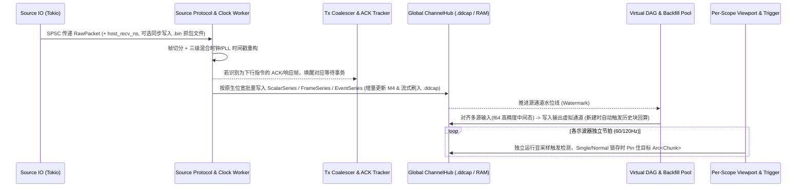

# Rust 核心引擎详细设计 (`ddscope-core`)

本文档定义 `ddscope-core` 各核心模块的数据结构、并发流水线与 Rust Trait 接口契约。

---

## 1. 多源并发与无锁流水线模型

系统以 **`CoreWorkspace`** 为根容器，管理多个并发运行的 **`SourceSession`**（每个数据源独立 IO 与协议线程），所有解析产出汇入无锁并发可读的 **`ChannelHub`**：



---

## 2. 接口层与抓包录制 (`transport`)

### 2.1 首期内置传输实现
1. **`SerialTransport`**：支持标准及超高速自定义波特率（如 `2Mbps ~ 12Mbps` USB-CDC）、流控（RTS/CTS、DTR）、热插拔自动重连。
2. **`TcpClientTransport` / `TcpServerTransport`**：启用 `TCP_NODELAY` 与大环形套接字缓冲；Server 模式支持按客户端连接标记 `source_tag`。
3. **`UdpTransport`**：支持单播、组播（Multicast）与广播，`socket2` 配置 MB 级内核接收缓冲区，满足百兆/千兆网口 >1M 点/秒突发流。
4. **`RawFileReplayTransport`**：面向未解析的原始设备文件（如 SD 卡 `.bin` 裸数据、串口抓取的 `.log`）：
   - **全速离线解析模式**：`memmap2` 零拷贝内存映射，以 GB/s 速度灌入协议引擎瞬间还原完整波形。
   - **倍速仿真回放模式**：支持 `0.1x ~ 20x` 倍速、暂停、进度条跳转（Seek）、循环回放。
5. **`SimSignalTransport`**：内置超高速压测与演示信号源（可叠加多频正弦、方波、PWM、白噪声、偶发窄脉冲毛刺、状态机跳变，用于无硬件时验证 >5M 点/秒链路与单次触发捕获）。
6. **`RawByteRecorder`（旁路原始抓包器）**：可在任意接口上随时开启/关闭，将 RX/TX 原始字节块连同纳秒级时间戳顺序落盘为 `.bin` / `.ddraw`，便于协议排错复现。
7. **扩展预留位**：`TransportFactory` 注册表预留 `UsbBulk`（WinUSB/libusb）、`DebugProbeRtt`（J-Link / probe-rs RTT）与 `CanFd` 接入能力。

### 2.2 发送队列：最新值合并（Coalescing）与优先级调度

为防止用户在 UI 上快速拖动调参滑块（如 120Hz 触发事件）打爆低速串口缓冲区，接口发送端内置 **双层队列**：

```rust
pub struct OutboundFrame {
    pub payload: Bytes,
    pub priority: TxPriority,
    /// 可选合并键（例如 "uart1:write:foc.kp"）：
    /// 若队列中尚有同一 coalesce_key 的未发送帧，直接原地替换为最新值，零积压延迟！
    pub coalesce_key: Option<String>,
    /// 关联的事务 ID（用于跟踪发送完成时刻以启动 ACK 超时计时器）
    pub transaction_id: Option<u64>,
}
```

---

## 3. 三级混合时钟与去抖动引擎 (`clock`)

针对 USB-CDC / 以太网分包造成的「微秒级突发到达（Burstiness）」以及多数据源之间的晶振时钟偏差，每个数据源配置独立的 **`StreamClockSynchronizer`**：

| 时钟层级 | 触发条件 | 核心算法 |
| :--- | :--- | :--- |
| **Tier 1: 硬件时钟锚定** | 协议帧内含设备硬件计数器（如 `tick_us: u32` 或 `ts_ns: u64`） | 自动处理计数器溢出回绕（Wrap-around），并通过滑动窗口最小二乘/PI 滤波估算硬件时钟相对 `host_mono_ns` 的偏移 $\beta$ 与频偏斜率 $\alpha \approx 1.0 \pm \text{ppm}$，将硬件时间平滑映射到全局统一时间轴 |
| **Tier 2: 软件 PLL 均匀重构** | 协议无时间戳，但属于等间隔高速采样流（已知标称采样率 $f_s$ 或开启自适应估计） | 利用二阶软件锁相环（Software PLL）跟踪数据包的长期平均到达率，动态微调单步周期 $\hat{\Delta t}$；对同一突发包内的 $K$ 个样本生成严格等间隔序列 $t_i = t_{\text{base}} + i \cdot \hat{\Delta t}$，彻底消除阶梯抖动 |
| **Tier 3: 主机到达时间** | 异步事件帧、日志字符串或非周期状态报文 | 直接赋予 `RawPacket.host_timestamp_ns` |

---

## 4. 双向协议引擎与 `.ddproto` 配置编译系统 (`protocol`)

### 4.1 声明式多帧协议规范 (`.ddproto`) 与 C Struct 一键导入

为让用户**零代码接入 95% 以上的单片机 / FPGA / DSP 私有二进制协议**，系统设计声明式 `.ddproto`（支持 YAML/JSON 存储及 UI 表单可视化编辑），并在加载时编译为紧凑指令序列（`CompiledFramePlan`）高速执行：

1. **帧边界与完整性校验**：
   - 支持固定帧头/帧尾魔数、可变帧长字段（`u8/u16/u32`，可配长度包含/不包含头部）、COBS / SLIP 转义帧，以及 `Sum8`、`Xor8`、`CRC8`、`CRC16-Modbus/CCITT`、`CRC32` 校验。
2. **多消息 `MsgID` 路由分发**：
   - 支持提取帧内功能码/消息 ID 字段（如 `offset = 2, type = u8`），路由到不同的自定义结构体 Schema（例如 `0x01 => HighSpeedFocFrame`, `0x02 => ThermalStatusFrame`, `0x81 => CommandAckFrame`）。
3. **丰富字段类型与嵌套展开**：
   - 标量（`bool`, `u8..u64`, `i8..i64`, `f32`, `f64`，独立可控大小端与线性物理量换算 `scale * raw + offset`）。
   - **位域提取（Bitfields）**：如从 `u16 fault_reg` 中直接声明 `bit 0 => over_current (bool)`, `bits 1..3 => hall_sector (u8)`。
   - **枚举状态映射（Enum Labels）**：如 `0 => "IDLE", 1 => "ALIGN", 2 => "RUN", 3 => "FAULT"`（供状态灯与示波器 MSO 状态色带直接使用）。
   - **嵌套结构体、定长数组（映射为 `FrameSeries` 或展开子通道）与定长/零结尾/长度前缀字符串**。
4. **C 语言 `struct` 粘贴导入器**：
   - 内置轻量 C 结构体词法/语法解析器（支持 `#pragma pack`、`__attribute__((packed))`、`stdint.h` 类型、数组、位域及行尾注释自动提取字段描述与单位），用户直接复制下位机 C 头文件中的 `typedef struct { ... }` 即可一键生成 `.ddproto` 字段表。

### 4.2 下行编码与请求-应答事务跟踪器 (`TransactionTracker`)

协议引擎同时负责下行控制闭环，支持两种发送语义：

```rust
#[derive(Debug, Clone, Serialize, Deserialize)]
pub enum DownlinkMode {
    /// 单向直发（配合 coalesce_key 实现高频滑块无积压调参）
    FireAndForget { coalesce: bool },
    /// 请求-应答闭环事务（等待协议解析器从上行流匹配到对应 ACK/响应帧）
    AckTransaction {
        timeout_ms: u32,
        max_retries: u8,
        expected_ack_matcher: AckMatcherRule, // 匹配指定 MsgID、回显序号或 Modbus 功能码
    },
}

#[derive(Debug, Clone, Serialize, Deserialize)]
pub enum TransactionResult {
    SentFireAndForget,
    AckSuccess { rtt_us: u64, payload: Option<Value> },
    AckRejected { error_code: i64, reason: String },
    TimedOut { attempts: u8 },
}
```

### 4.3 首期内置四大协议族
- **`JustFloat` / `RawBinary`**：VOFA+ 兼容高速浮点帧及纯裸数组流。
- **`FireWater`**：SIMD 换行扫描加速的 CSV 文本流协议（自动识别列数与混合字符串消息）。
- **`DeclarativeFrame` (`.ddproto` 引擎)**：上述免编程多消息自定义二进制结构体协议引擎。
- **`Modbus` (`RTU` & `TCP`)**：内置后台周期读轮询器（自动聚合并写入通道）+ 下行 `05/06/0F/10` 写指令及异常码应答事务闭环。

---

## 5. 多模态通道中心与 `.ddcap` 存储引擎 (`storage`)

### 5.1 原生位宽存储与三类标准通道形态

所有通道挂载在 `<source_id>/<path>`（如 `uart1/foc.iq`）或 `virtual/<path>` 下，分为三种核心形态：

```rust
pub enum ChannelStore {
    /// 1. 标量时序流：按原生位宽分块存储 + 多级 M4 降采样金字塔
    Scalar(NativeScalarSeries),
    /// 2. 一维数组/帧时序流：如 1024 点实时 FFT 频谱帧、线阵传感器扫描帧
    Frame(FrameTimeSeries),
    /// 3. 结构体快照与离散事件流：完整自定义结构体值、枚举状态跳变、字符串日志
    Event(EventTimeSeries),
}

pub enum NativeScalarColumn {
    Bool(BitVecChunk), // 1 bit/sample 极高压缩比，配套跳变边沿索引供 MSO 逻辑带渲染
    U8(AlignedVec<u8>),   U16(AlignedVec<u16>), U32(AlignedVec<u32>), U64(AlignedVec<u64>),
    I8(AlignedVec<i8>),   I16(AlignedVec<i16>), I32(AlignedVec<i32>), I64(AlignedVec<i64>),
    F32(AlignedVec<f32>), F64(AlignedVec<f64>),
}
```

- **原生位宽优势**：例如 16 位高速 ADC 采集 8 路通道 @ 2M 点/秒，采用原生 `I16` 存储仅占 `32 MB/s`（若统一转 `f64` 则高达 `128 MB/s`），CPU 缓存命中率与落盘续航提升 4 倍！M4 包络树统一存储量化转换后的物理量 `f32` 包络以便直接喂给 GPU。
- **`FrameTimeSeries` 元数据**：携带 `frame_len: usize` 及横轴标尺 `AxisMeta { origin: f64, step: f64, unit: String }`（例如 FFT 频谱 `origin = 0 Hz, step = fs / N Hz, unit = "Hz"`）。

### 5.2 分块内存配额、Chunk Pinning 与 `.ddcap` 流式 `mmap`

1. **不可变分块（Immutable Sealed Chunks）**：每个块写满（如 `64K` 点）后封存为 `Arc<DataChunk>`。
2. **内存块钉住（Chunk Pinning）**：当任意示波器在 `Single` / `Normal` 触发模式捕获到关键波形窗口时，该示波器控制器会克隆并持有覆盖 `[t_start, t_end]` 的 `Vec<Arc<DataChunk>>`（或将其标记为 Pinned），即使全局环形缓冲区继续高速运行数十分钟覆盖了旧循环槽位，被锁存的故障现场数据依然**精确驻留内存，支持随时放大到单采样点观察**；解除锁存（Run）后引用计数归零自动释放。
3. **双模式持久化（纯内存环形 + 可选 `.ddcap` 录制）**：
   - 未开启录制时：严格受控于用户设定的内存上限（默认 `2 GB`），FIFO 淘汰未钉住的最旧块。
   - 开启 `.ddcap` 录制时：后台异步写盘线程将封存的列式 `DataChunk` 与对应层级的 `M4Bucket` 块追加写入 `.ddcap` 文件；被移出热内存的旧块自动转为指向 `.ddcap` 对应文件偏移量的 **`memmap2` 虚拟页引用**，实现边录边回看数十 GB 历史波形。

---

## 6. 虚拟通道 DAG、公式编译器与历史回算 (`dag`)

### 6.1 双入口统一计算图
无论是用户在 UI 输入一行公式，还是用节点连线图搭建复杂拓扑，底层均统一编译为 `VirtualDagNode`：
1. **轻量数学表达式编译器（Formula Compiler）**：
   - 支持语法如 `(uart1/adc.v_raw - 2048) * 0.001611`、` hypot(foc.i_alpha, foc.i_beta)`、`abs(v_ref - v_fb) > 0.5`。
   - 解析为 AST 后做常量折叠，并编译为栈式/寄存器式紧凑字节码（针对连续切片循环做向量化批量求值，杜绝逐点 AST 递归解释）。
2. **多进多出有状态算子（`N Inputs -> M Outputs`）**：
   - **高精度内部状态保证**：凡涉及跨样本累积的有状态算子（如 IIR 二阶滤波器 Biquad、PID 仿真、数值积分、滑动 RMS），即使输入通道为 `i16` 或 `f32`，**算子内部状态变量强制采用 `f64` 双精度运算**，防止高频采样下出现极点数值发散或积分截断误差。
   - **内置算子矩阵**：四则与标定、微积分、滑动统计（RMS/Mean/Vpp）、滤波器组（RC / Butterworth / Notch 陷波 / 中值滤波）、实时加窗 FFT（输出 `FrameSeries` 频谱通道 + 主频/THD `ScalarSeries` 通道）、电机坐标变换（Clarke/Park）、位域解包器、多源时间对齐器（同帧索引 / 零阶保持 / 线性重采样）。

### 6.2 历史分块即时回溯重算（Retroactive Backfill）
当处于暂停、单次触发锁存或打开离线捕获文件时，若用户**新增或修改了某个虚拟通道参数（例如调整低通滤波器截止频率观察去噪效果）**：
1. **视口优先调度（Viewport-First Scheduling）**：`BackfillCoordinator` 优先读取当前活跃示波器屏幕时间窗口内的源通道历史块，在数毫秒内率先算出当前屏幕可见的虚拟通道波形并刷新 UI！
2. **后台全量补齐**：随后 `rayon` 线程池在后台并行扫描其余历史分块完成全量重算与 M4 金字塔构建，并与实时流无缝衔接在水位线（Watermark）处。

---

## 7. 插件扩展预留 (`plugin`)

通过 `ddscope-plugin-api` 将内部 `ProtocolCodec` 与 `VirtualOperator` 抽象隔离：
- **一期**：全部内置协议、`.ddproto` 引擎与 DSP 算子通过统一 `EngineRegistry` 静态注册。
- **远期扩展**：无需重构核心管线，即可挂载基于 `wasmtime`（WIT 接口沙箱）的跨平台插件，或基于 `#[repr(C)]` 稳定 ABI 的原生 `.dll / .so` 高性能采集与算法插件。
