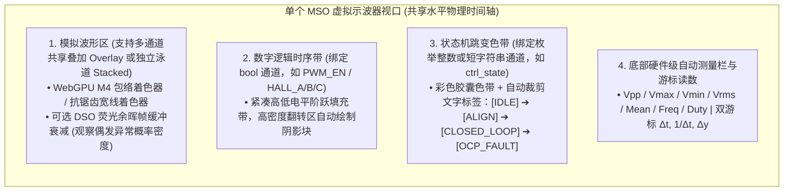

# 跨端高速通信、React 19 工作区与 MSO 虚拟示波器设计

本文档定义 `ddscope-tauri` 跨端通信协议、`ddscope-ui`（React 19 + TypeScript）拖拽面板与双向绑定体系，以及核心控件 **MSO 混合信号实时虚拟示波器（WebGPU / WebGL2）** 的完整实现规范。

---

## 1. 跨端通信层设计 (`ddscope-tauri`)

### 1.1 控制面（`tauri-specta` 强类型 Commands & Events）
所有控制面指令通过 `specta` 自动从 Rust 导出 TypeScript 函数签名，零手写胶水代码：
- **多源连接管理**：`create_source`, `start_source`, `stop_source`, `toggle_raw_recorder`, `seek_file_source`
- **协议与 `.ddproto` 工具链**：`load_source_protocol`, `import_c_struct_to_schema`（粘贴 C 结构体即时解析预览）, `start_ddcap_recording`
- **虚拟通道编排**：`upsert_formula_channel`, `upsert_dag_graph`（保存后自动触发视口优先历史回算）
- **多示波器视口与同步组**：`register_scope_viewport`, `update_scope_config`（时基、像素宽度、独立触发配置、`sync_group_id`）, `rearm_single_trigger`
- **下行命令与事务执行**：`dispatch_downlink_action` —— 根据配置的发送模式，立即返回 `SentFireAndForget` 或异步等待并返回 `TransactionResult`（`AckSuccess { rtt_us }` / `TimedOut` / `AckRejected`）。

### 1.2 数据面（`DDSF` 多模态零拷贝二进制帧协议）
采用 **64 字节对齐紧凑二进制帧**，支持在单次内存共享/二进制推送中携带多个独立示波器视口的模拟包络、数字逻辑边沿、状态色带区间与实时频谱帧：

```text
+-------------------------------------------------------------------------+
| DDSF FrameHeader (32 Bytes)                                             |
|   magic: 0x44445346 ("DDSF") | frame_seq: u32 | host_now_ns: u64        |
|   scope_packet_count: u16    | snapshot_count: u16 | flags: u32         |
+-------------------------------------------------------------------------+
| ScopeViewportPacket[0..S] (每个示波器实例独立头部，互不干扰！)          |
|   scope_id: u32        | trigger_state: u8 (Armed/Triggered/Latched/Roll)|
|   subpixel_offset: f32 | win_t_start_ns: u64  | win_t_span_ns: u64      |
|   block_count: u16                                                      |
|   ├── Block (AnalogRawF32 / AnalogM4Envelope): 连续 f32 顶点切片        |
|   ├── Block (DigitalEdges): 跳变时间归一化坐标 f32[] + 初始电平         |
|   ├── Block (StateRibbon):  区间 [x0, x1, state_code, color_id][]       |
|   └── Block (SpectrumFrame): 频谱幅值 f32[] + (f_start, df)             |
+-------------------------------------------------------------------------+
| Latest Value Snapshots (供数值卡、仪表盘、状态灯、结构体表 30~60Hz 消费) |
+-------------------------------------------------------------------------+
```

- **Windows 零拷贝快车道**：基于 `WebView2` `CoreWebView2SharedBuffer` 双缓冲共享内存槽（Double-Buffered Shared Memory Slots），Rust 写完槽位后仅发一个 8 字节轻量通知，前端直接从 `SharedArrayBuffer` 切片上传显存。
- **跨平台通用快车道**：基于 Tauri v2 `tauri::ipc::Channel` 原生 `Raw` 二进制体直传 `ArrayBuffer`。

---

## 2. 核心控件：MSO 混合信号实时虚拟示波器 (`scope-engine`)

### 2.1 多实例独立触发与同步组协同（`Per-Scope Independence`）
工作区允许同时拖入任意多个虚拟示波器控件，每个控件在 Rust 核心对应独立的 `ScopeController`：
1. **独立触发锁存**：
   - 例如：**示波器 1** 设为 `10 μs/div` + `Single` 单次触发监控 `uart1/foc.ia > 25.0 A` 过流保护瞬间；**示波器 2** 设为 `2 s/div` + `Roll` 滚动模式持续监控温度与母线电压趋势。
   - 当过流毛刺发生时，示波器 1 精准锁存触发前后全精度波形（并在 Rust 端自动 **Pin 住对应 `Arc<DataChunk>` 防环形覆盖**），而示波器 2 和面板上的所有仪表盘**完全不受打断，继续实时刷新**！
2. **同步组（`SyncGroup`）一键联动**：
   - 用户可将多个示波器（如上下排列的「三相电流示波器」与「控制环路误差示波器」）设为同一同步组（如 `Group A`），此时滚轮缩放时基、拖拽平移历史时间轴或移动垂直测量游标将在组内所有示波器间毫秒级同步联动。

### 2.2 四大触发模式与丰富触发类型
- **采集模式**：`Roll`（无触发平滑滚动）、`Auto`（有触发锁存，超时自动刷新基线）、`Normal`（仅触发时刷新并保持上一帧）、`Single`（单次抓拍锁存并钉住内存块）。
- **触发条件**（全精度运行于 Rust 核心，支持亚采样点线性内插消抖）：
  - 边沿触发（上升沿 / 下降沿 / 双边沿 + 可调抗噪迟滞环 `Hysteresis`）
  - 窗口触发（进入上下限窗口 / 越出安全窗口）
  - 脉宽触发（高/低电平持续时间 `> T` 或 `< T`，精准抓窄毛刺或通信超时）
  - 逻辑状态触发（当状态通道跳变至指定枚举值如 `FAULT` 时立即触发！）

### 2.3 MSO 混合信号分层渲染管线（WebGPU 主 / WebGL2 回退）

同一示波器内支持四种信号轨道同屏微秒级对齐：



此外支持一键切换子视图模式：
- **频谱视图（Spectrum / FFT Mode）**：直接绑定虚拟通道输出的 `FrameSeries` 实时频谱帧，支持 dBV / 线性幅值切换、峰值自动寻峰标注（Peak Table）。
- **XY 相平面模式（Lissajous Mode）**：任意绑定两路通道作为 X/Y 轴（支持余晖拖尾渐变，观察电机磁链圆、编码器正交性或滞回环）。

---

## 3. React 19 工作区、拖拽网格与虚拟通道编排 (`workspace`)

### 3.1 多视口停靠（Dockview）+ 细粒度磁吸网格画布
- **全局停靠框架（`Dockview`）**：
  - 左侧可折叠侧边栏：**全局多源通道与命令树**（实时显示各数据源连接状态、帧率/带宽统计、通道实时值预览）+ **控件箱**。
  - 中央主工作区：支持多标签页、任意左右/上下分屏停靠，大尺寸示波器、日志抓包台或虚拟通道编辑器可直接独占一个分屏窗格，也可点击按钮弹出为独立原生多显示器窗口。
- **自定义测控仪表盘窗格（`24 / 48 列自适应网格画布`）**：
  - 基于 `React-Grid-Layout` 深度定制细粒度磁吸网格，支持 **「编辑布局态（Design）」** 与 **「锁定运行态（Operate）」** 一键切换。
  - **极简拖拽绑定交互**：不仅可以从控件箱拖控件上画布，还可以**直接从左侧全局通道树把任意通道（如 `uart1/foc.iq`）拖到画布上的示波器或表盘上完成绑定**；把任意下行命令（如 `uart1/cmd.set_kp`）拖到滑块或按钮上完成控制绑定！

### 3.2 虚拟通道双入口编排体验 (`dag-editor`)
1. **快捷公式栏（Formula Quick-Create）**：
   - 在左侧通道树点击 `+ 新建公式通道`，直接输入表达式（带通道路径自动补全与单位推导提示），如：
     `uart1/foc.v_dc * uart1/foc.i_dc` -> 立即生成 `virtual/power_in`，若是暂停状态则瞬间回算完整历史功率曲线！
2. **可视化算子连线图（`@xyflow/react` Node-Graph）**：
   - 面向多输入、多输出及有状态信号处理链：从算子库拖入 `Clarke 变换`、`二阶 Butterworth 低通`、`滑动窗口 FFT`、`多源时间重采样器` 等节点，连线端口即可构建复杂拓扑，每个节点上可实时预览参数并支持在线热改参数即时回算。

### 3.3 双向控件契约与下行事务状态反馈

所有反向控制控件共享统一的事务反馈视觉语言：
- **高频无阻塞直发模式（如拖动 PID 滑块 / 旋钮）**：按设定节流周期（如 `20ms`）配合底层 `coalesce_key` 丝滑连续下发，无弹窗阻塞。
- **ACK 事务确认模式（如点击「写入参数表单」「切换运行模式开关」「Modbus 写寄存器」）**：
  - 发送瞬间控件边缘呈现微动加载态（`Pending`）；
  - 收到设备应答帧后闪现绿色确认徽标及往返耗时（如 `✓ 1.4ms`）；
  - 若重试耗尽仍超时或被设备 NACK 拒绝，控件高亮红色警示并浮出具体错误原因（`Timeout` / `ErrCode: 0x03`），可选恢复修改前旧值。

### 3.4 首期与进阶标准控件矩阵
| 类别 | 控件名称 | 支持绑定槽位 | 核心特性 |
| :--- | :--- | :--- | :--- |
| **波形与分析** | **MSO 实时虚拟示波器** | `N` 路标量/布尔/枚举/频谱帧 | 独立触发锁存、Chunk Pinning、模拟+逻辑+状态色带、游标、XY、余晖 |
| **数据监控** | **数字读数指标卡** | `1` 路标量 + 迷你趋势线 | 高刷新率直接 DOM/Canvas 更新，支持阈值越限变色闪烁 |
| **数据监控** | **圆弧/柱状仪表盘** | `1` 路标量 | 可配量程刻度、警戒区间色弧、峰值保持指针 |
| **数据监控** | **状态指示灯 / 位域面板** | `1..N` 路布尔或状态枚举 | 支持多色状态映射、故障闪烁锁存提示 |
| **数据监控** | **自定义结构体监视表** | `Struct` 节点或任意通道组 | 树形展开嵌套结构体全部字段，可写字段支持行内直接改值并带 ACK 下发 |
| **数据监控** | **报文与日志终端** | `String` 通道或底层源收发流 | 虚拟滚动支撑百万行，HEX / ASCII 双视图、帧高亮、正则过滤 |
| **反向控制** | **指令按钮（含点动模式）** | 下行命令 / 原始 HEX 帧 | 单击发送、按住持续/按下松开双指令（Jog 点动）、高危指令二次确认、快捷键 |
| **反向控制** | **双向调参滑块 / 旋钮** | 读反馈通道 + 写命令/通道 | 同时显示目标设定值与设备实际回读值，支持步进微调与节流合并直发 |
| **反向控制** | **档位开关 / 模式选择器** | 读状态通道 + 写枚举命令 | 直观切换设备状态机模式，支持 ACK 确认后才切换激活态 |
| **反向控制** | **结构化参数下发面板** | 多参数协议命令 (`CommandForm`) | 自动根据协议命令参数 Schema 生成类型化输入表单，一键打包原子发送并校验 ACK |

---

## 4. 工程文件与录制资产体系

| 文件后缀 | 用途与格式 | 特性 |
| :--- | :--- | :--- |
| **`.ddscope.json`** | 工作区完整工程配置 | 保存多源连接配置、引用的 `.ddproto` 协议、虚拟通道公式与连线图、Dockview 与网格面板全部控件布局及双向绑定（纯文本 JSON，Git 友好） |
| **`.ddproto.yaml`** | 声明式自定义协议包 | 独立可复用的设备通信协议定义（含上行 `MsgID` 多帧结构体、位域、枚举及下行命令模板） |
| **`.ddcap`** | 高速流式捕获数据文件 | 自有二进制列式块 + 多级 M4 金字塔索引格式，支持 `mmap` 秒开百 GB 文件与录制中实时回溯 |
| **`.bin` / `.csv` / `.npz`** | 原始抓包与通用科学导出 | 接口层裸字节抓包（`.bin`），以及示波器选区导出给 Python / MATLAB 二次分析 |

---

## 5. 分阶段实施路线图（Roadmap）

| 阶段 | 核心目标 | 关键交付物与验收标准 |
| :--- | :--- | :--- |
| **Phase 1: 超高速多源底座与 MSO 示波器闭环 (MVP)** | 跑通「多源接入 -> 混合时钟/PLL -> 原生位宽存储 + M4 -> 零拷贝桥 -> WebGPU 独立触发示波器」，实测验证 **> 1M ~ 5M 点/秒 @ 60/120fps** | 1. Rust Workspace + Tauri v2 + React 19 + Dockview 基础框架<br/>2. 接口层：`SimGenerator`（高速含毛刺/逻辑/状态混合信号源）、`Serial`、`UDP`、`TCP`、`RawFileReplay`<br/>3. 协议层：`JustFloat`、`FireWater` 及基础下行发送合并队列<br/>4. 存储与触发：原生位宽分块环形存储、M4 金字塔、独立示波器亚采样触发器与 `Chunk Pinning`<br/>5. UI：全局多源通道树 + WebGPU/WebGL2 MSO 示波器（Roll/Auto/Normal/Single、模拟+逻辑带+状态色带、无级缩放、双游标、SyncGroup） |
| **Phase 2: `.ddproto` 免代码协议、ACK 事务与虚拟通道引擎** | 解决复杂私有结构体协议接入、可靠反向控制与实时信号处理 | 1. `.ddproto` 多消息 `MsgID` 编译执行引擎 + UI 协议编辑器 + **C `struct` 粘贴一键导入**<br/>2. `Modbus (RTU/TCP)` 协议与下行 **请求-应答事务跟踪器（ACK Tracker）**<br/>3. 虚拟通道引擎：数学公式字节码编译器 + React Flow 连线节点图 + 内置算子库（标定/滤波/微积分/实时 FFT `FrameSeries`）+ **视口优先历史即时回算** |
| **Phase 3: 自由拖拽测控面板与 `.ddcap` 海量录制** | 打造完整工业级双向测控工作台与长时高速记录能力 | 1. 24/48 列磁吸自适应网格画布（设计态/运行态、通道树直接拖拽绑定）<br/>2. 完整监控与反向控制控件库（指标卡、表盘、状态灯、结构体监视表、点动按钮、双向滑块、模式开关、参数表单、抓包终端）<br/>3. `.ddcap` 流式落盘与 `mmap` 超大文件秒开回溯 + `.ddscope.json` 工程导入导出 |
| **Phase 4: 专业分析进阶与外部插件生态** | 高级硬件级分析特性与第三方生态开放 | 1. 示波器荧光余晖热力图、XY 相平面模式、窗口/脉宽高级触发、CSV/NPZ 选区导出<br/>2. 电机控制等垂直领域算子包、3D 姿态控件<br/>3. 开放 `ddscope-plugin-api`（WASM 沙箱插件与原生 C-ABI 动态库插件加载器） |
