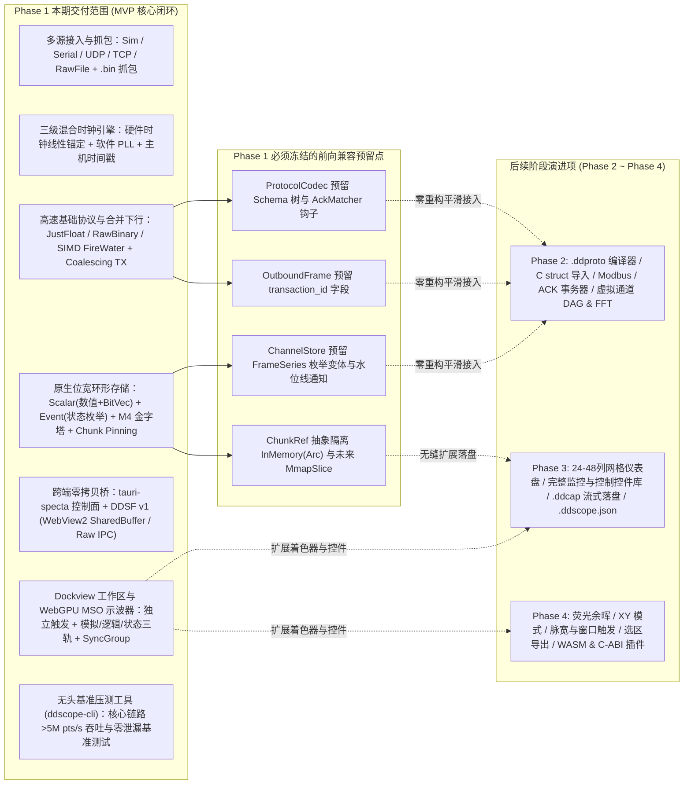
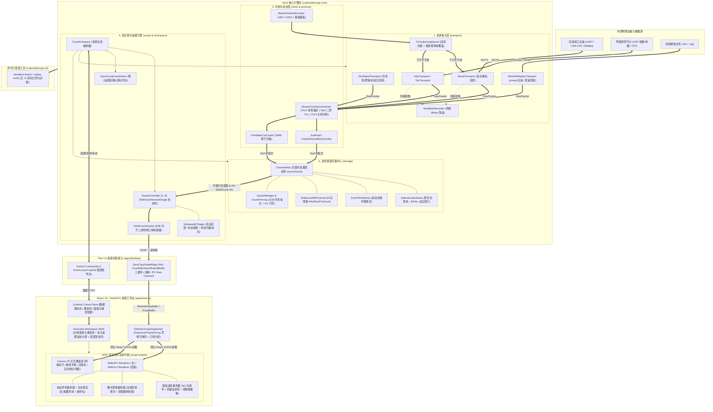
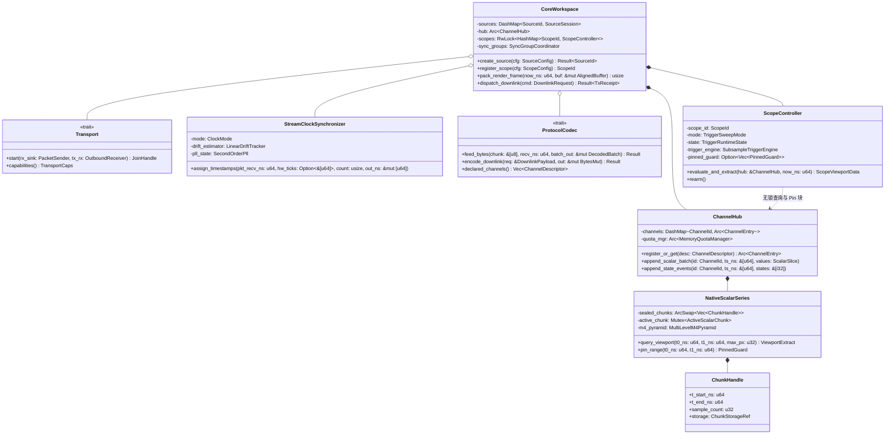
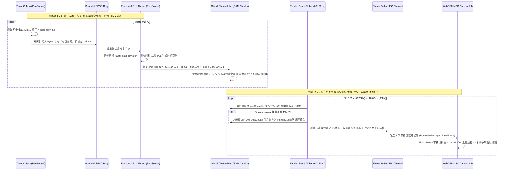
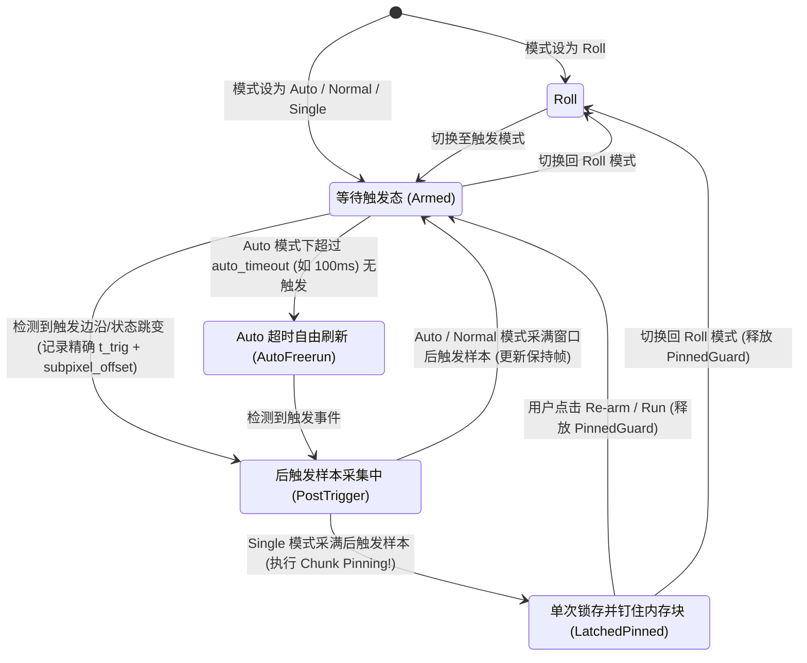
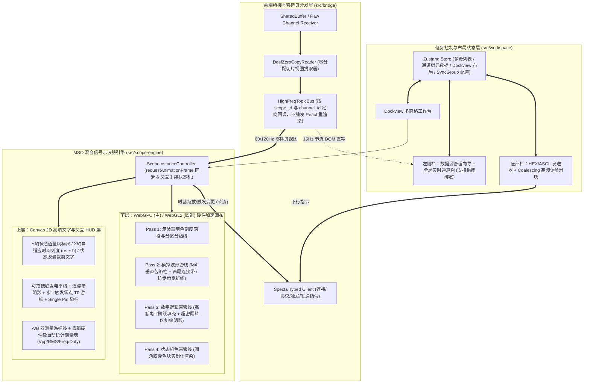
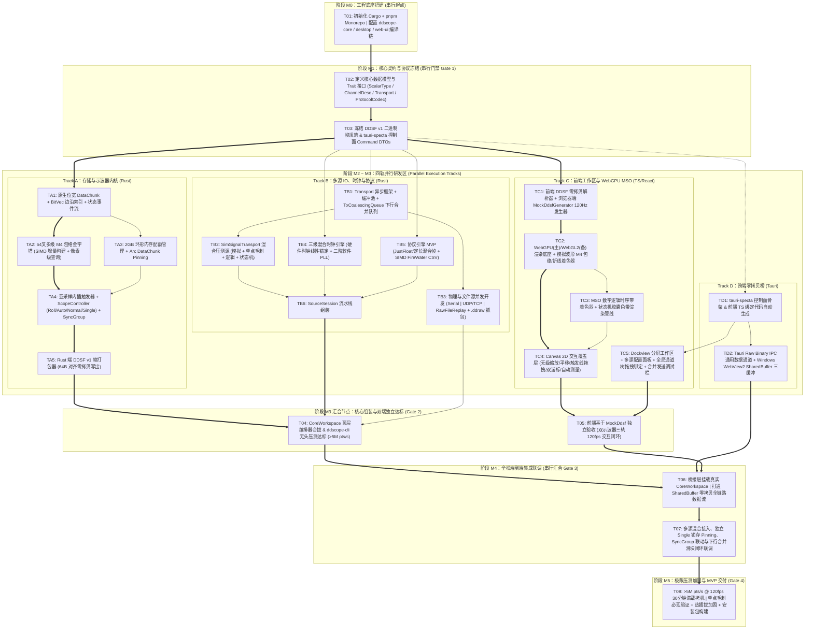
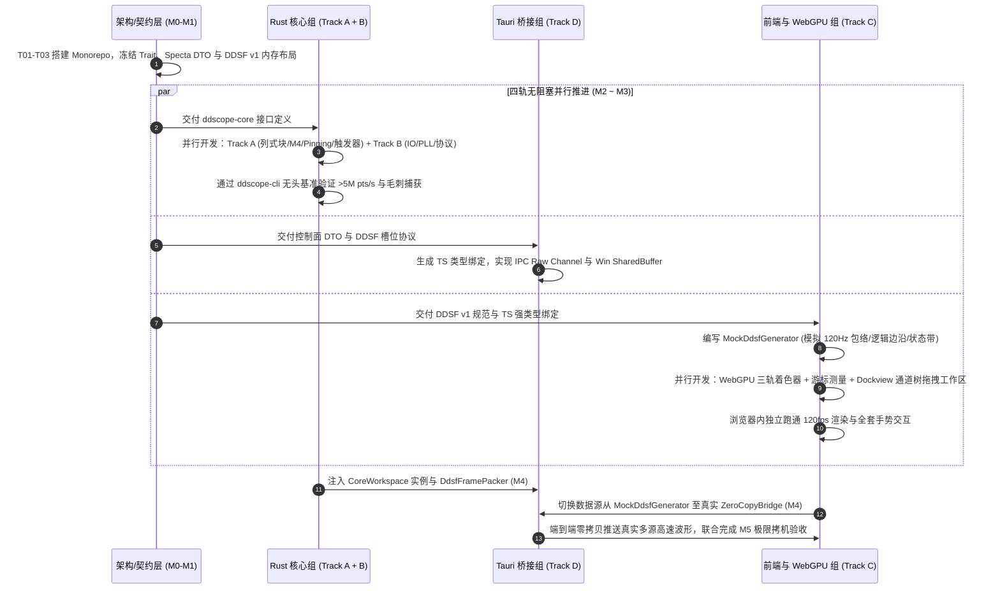

# DDScopeHost Phase 1 (MVP) 需求拆解、详细设计方案与开发实施计划

> **阶段定位**：Phase 1 — 超高速多源底座与 MSO 混合信号示波器闭环（MVP）
> **核心目标**：端到端打通「多源并发接入 ➔ 三级混合时钟/PLL ➔ 原生位宽分块存储 + M4 金字塔 ➔ 零拷贝二进制桥 ➔ WebGPU 独立触发 MSO 示波器 + 下行合并直发」，实测跑通 **> 1M ~ 5M 点/秒持续吞吐 @ 60/120 fps** 丝滑渲染与单点毛刺锁存。

---

## 目录

1. [Phase 1 需求拆解与范围界定](#1-phase-1-需求拆解与范围界定)
   - 1.1 [业务闭环与范围边界（In-Scope vs. Deferred）](#11-业务闭环与范围边界in-scope-vs-deferred)
   - 1.2 [功能需求拆解矩阵（FR）](#12-功能需求拆解矩阵fr)
   - 1.3 [非功能与性能基线指标（NFR）](#13-非功能与性能基线指标nfr)
2. [Phase 1 总体技术方案与系统框架图](#2-phase-1-总体技术方案与系统框架图)
   - 2.1 [Phase 1 系统分层结构框图](#21-phase-1-系统分层结构框图)
   - 2.2 [`ddscope-core` 核心类与 Trait 框架图](#22-ddscope-core-核心类与-trait-框架图)
   - 2.3 [无锁并发线程模型与数据流向图](#23-无锁并发线程模型与数据流向图)
3. [核心子系统详细设计方案](#3-核心子系统详细设计方案)
   - 3.1 [多源传输层与下行合并队列 (`transport`)](#31-多源传输层与下行合并队列-transport)
   - 3.2 [三级混合时钟与二阶软件 PLL (`clock`)](#32-三级混合时钟与二阶软件-pll-clock)
   - 3.3 [协议引擎 MVP 与扩展契约 (`protocol`)](#33-协议引擎-mvp-与扩展契约-protocol)
   - 3.4 [原生位宽列式存储、M4 金字塔与 Chunk Pinning (`storage`)](#34-原生位宽列式存储m4-金字塔与-chunk-pinning-storage)
   - 3.5 [多实例独立触发控制器与同步组 (`scope`)](#35-多实例独立触发控制器与同步组-scope)
   - 3.6 [跨端控制面与 `DDSF v1` 零拷贝数据桥 (`apps/desktop`)](#36-跨端控制面与-ddsf-v1-零拷贝数据桥-appsdesktop)
   - 3.7 [Dockview 工作区与 WebGPU/WebGL2 MSO 渲染框架 (`apps/web-ui`)](#37-dockview-工作区与-webgpuwebgl2-mso-渲染框架-appsweb-ui)
4. [Phase 1 开发步骤规划与串并联流程图](#4-phase-1-开发步骤规划与串并联流程图)
   - 4.1 [工程解耦策略：契约先行与双端独立自测](#41-工程解耦策略契约先行与双端独立自测)
   - 4.2 [开发阶段划分（M0 ~ M5）与并行轨道设计](#42-开发阶段划分m0--m5与并行轨道设计)
   - 4.3 [Phase 1 开发主流程图（前后关系、依赖关系与串并联拓扑）](#43-phase-1-开发主流程图前后关系依赖关系与串并联拓扑)
   - 4.4 [双端解耦并行开发与汇合联调时序图](#44-双端解耦并行开发与汇合联调时序图)
   - 4.5 [WBS 任务清单与依赖关系详表](#45-wbs-任务清单与依赖关系详表)
5. [里程碑验收标准与技术风险预案](#5-里程碑验收标准与技术风险预案)
   - 5.1 [阶段门禁与最终验收清单（DoD）](#51-阶段门禁与最终验收清单dod)
   - 5.2 [关键技术风险与降级预案](#52-关键技术风险与降级预案)

---

## 1. Phase 1 需求拆解与范围界定

### 1.1 业务闭环与范围边界（In-Scope vs. Deferred）

Phase 1 聚焦**验证超高速架构底座的性能上限与 MSO 虚拟示波器核心体验**，同时在核心数据结构与 Trait 边界上为 Phase 2~4 预留零重构扩展槽位。



### 1.2 功能需求拆解矩阵（FR）

| 需求编号           | 所属模块   | 需求名称                              | 详细功能规格                                                                                                                                                                                                                | 优先级 |
| :----------------- | :--------- | :------------------------------------ | :-------------------------------------------------------------------------------------------------------------------------------------------------------------------------------------------------------------------------- | :----- |
| **FR-WS-01** | 基础工程   | Monorepo 与跨端脚手架                 | 建立 Cargo Workspace（`ddscope-core`, `ddscope-cli`, `ddscope-plugin-api`）与 pnpm Workspace（`apps/desktop`, `apps/web-ui`），打通 `tauri-specta` 自动生成 TypeScript 类型绑定                                 | P0     |
| **FR-IO-01** | 传输层     | 内置混合信号压测源 (`SimGenerator`) | 支持可调采样率（`1 kHz ~ 10 MHz`），同步生成多路正弦/方波/三角波/白噪声、**周期或偶发单采样点窄脉冲毛刺**、数字 `bool` 方波/PWM 及周期切换的状态机枚举值                                                          | P0     |
| **FR-IO-02** | 传输层     | 高速串口接入 (`Serial`)             | 支持枚举系统串口、自定义高波特率（最高 `12 Mbps` USB-CDC）、数据位/校验位/停止位、RTS/CTS 与 DTR 流控、设备拔插自动重连与状态上报                                                                                         | P0     |
| **FR-IO-03** | 传输层     | 网络传输接入 (`UDP` / `TCP`)      | UDP 支持单播/组播/广播及 MB 级内核接收缓冲；TCP 支持 Client（自动重连）与 Server（多连接标识）模式，默认开启 `TCP_NODELAY`                                                                                                | P0     |
| **FR-IO-04** | 传输层     | 原始文件回放 (`RawFileReplay`)      | 支持加载 `.bin` / `.log` 原始字节流文件；支持 **全速 `mmap` 离线秒解模式** 与 **倍速仿真回放模式**（`0.1x ~ 20x`、暂停/恢复、进度条 Seek、循环开关）                                                    | P1     |
| **FR-IO-05** | 传输层     | 旁路裸字节抓包 (`RawRecorder`)      | 任意活跃数据源可随时开启/停止旁路抓包，将 RX/TX 原始字节流附带纳秒时间戳写入 `.ddraw` / `.bin` 文件，不阻塞解析主链路                                                                                                   | P1     |
| **FR-IO-06** | 传输层     | 下行发送合并队列 (`TxCoalescer`)    | 双优先级发送队列（高优即时帧 / 普通控制帧）；携带相同 `coalesce_key` 的未发出帧直接在队列中原地覆盖为最新值，杜绝高频滑块积压                                                                                             | P0     |
| **FR-CK-01** | 时钟引擎   | 三级混合时钟与软件 PLL                | 支持按源配置：① 硬件计数器线性斜率/偏移锚定（自动处理 u16/u32 溢出回绕）；② 二阶软件 PLL 重构突发包内等间隔样本网格；③ 主机单调接收时间 `host_mono_ns`                                                                 | P0     |
| **FR-PR-01** | 协议引擎   | `JustFloat` 与定长混合裸帧          | 兼容 VOFA+ `JustFloat` 帧尾（`00 00 80 7F`）高速 `f32` 数组解析；扩展支持固定列 Schema 配置（允许声明 `i16`/`u16`/`f32`/`bool`/枚举状态列及可选首列硬件 tick）                                                | P0     |
| **FR-PR-02** | 协议引擎   | SIMD 加速 `FireWater` 文本协议      | 基于向量化换行扫描解析高速 CSV 文本流，自动识别列数，支持数值列、布尔列与状态字符串标签提取                                                                                                                                 | P0     |
| **FR-PR-03** | 协议引擎   | 基础下行编码与透传                    | 支持发送原始 HEX / ASCII 报文及简单键值/模板参数帧（如 `kp=1.25\n` 或定长二进制参数包），绑定 `coalesce_key`                                                                                                            | P1     |
| **FR-ST-01** | 存储中心   | 原生位宽多模态列式存储                | 全局 `<source_id>/<channel>` 注册表；`ScalarSeries` 原生支持 `i8..i64`/`u8..u64`/`f32`/`f64` 及 `1-bit` 压缩 `BitVecChunk`（附跳变边沿索引）；`EventSeries` 支持状态枚举跳变序列                          | P0     |
| **FR-ST-02** | 存储中心   | 多级增量 M4 包络金字塔                | 数据块写入时同步更新分支因子 `64` 的多级 M4（`Min, Max, First, Last`）物理量 `f32` 金字塔，保证任意大时基下查询耗时 $O(\text{屏幕像素})$ 且绝不漏掉单点毛刺                                                         | P0     |
| **FR-ST-03** | 存储中心   | 内存配额环形回收与 `Chunk Pinning`  | 全局可配内存上限（默认 `2 GB`），按 FIFO 淘汰未被引用的最旧封存块；当示波器触发锁存时持有目标窗口 `Arc<DataChunk>` 引用，确保锁存波形不被后台持续采集覆盖                                                               | P0     |
| **FR-SC-01** | 示波器核心 | 多实例独立控制器与亚采样触发          | 每个前端示波器对应独立 `ScopeController`，支持 `Roll` / `Auto` / `Normal` / `Single` 四模式；支持边沿触发（上升/下降/双边沿 + 迟滞环 `Hysteresis`）与状态枚举触发，输出亚采样线性内插偏移 `subpixel_offset`   | P0     |
| **FR-SC-02** | 示波器核心 | 多示波器同步组 (`SyncGroup`)        | 支持将任意多个示波器加入同一 `SyncGroup`，组内时基缩放、历史窗口平移、垂直游标位置实时同步联动                                                                                                                            | P1     |
| **FR-BR-01** | 跨端桥接   | `DDSF v1` 零拷贝数据通道            | 按 60/120Hz 节拍将活跃示波器视口包（模拟包络/原始点、逻辑边沿、状态色带）与通道最新值快照打包为 64 字节对齐 `DDSF` 二进制帧；Windows 启用 `WebView2 SharedBuffer`，跨平台回退 Tauri Raw Binary Channel                  | P0     |
| **FR-UI-01** | 前端工作区 | Dockview 分屏与多源通道树             | 左侧提供多数据源连接配置面板与全局通道树（显示连接状态、实时采样率/带宽、通道最新值）；中央基于 `Dockview` 支持任意创建、拖拽分屏、标签页停靠多个 MSO 示波器视口；支持从通道树直接拖拽通道到任意示波器绑定                | P0     |
| **FR-UI-02** | 示波器渲染 | WebGPU/WebGL2 三轨 MSO 渲染           | WebGPU 主渲染管线（自动降级 WebGL2）+ Canvas 2D 标尺层；同屏微秒级对齐渲染：**① 模拟波形区**（Overlay/Stacked 切换）、**② 数字逻辑时序带**、**③ 状态机跳变胶囊色带**                                   | P0     |
| **FR-UI-03** | 示波器交互 | 无级导航、双游标与自动测量            | 鼠标滚轮无级缩放时基/幅值、拖拽平移历史、可视化拖拽触发电平线与触发水平预采样点、`Single` 锁存状态徽标与一键 `Re-arm`；内置双游标（`Δt, 1/Δt, Δy`）及窗口自动统计栏（`Vpp, Vmax, Vmin, Vrms, Mean, Freq, Duty`） | P0     |
| **FR-UI-04** | 前端工作区 | 轻量下行调试与高频滑块栏              | 底部可折叠发送调试栏，支持 HEX/ASCII 指令下发及可绑定 `coalesce_key` 的高频调参测试滑块，闭环验证全双工并发与发送合并                                                                                                     | P1     |

### 1.3 非功能与性能基线指标（NFR）

| 指标维度                       | 目标基线值                                                                                                                                      | 验证手段                                                          |
| :----------------------------- | :---------------------------------------------------------------------------------------------------------------------------------------------- | :---------------------------------------------------------------- |
| **持续摄入吞吐率**       | 单源或多源合计 **≥ 5,000,000 点/秒**（如 5 路 @ 1MHz 或 10 路 @ 500kHz），零丢包、无队列积压                                             | `ddscope-cli bench` + UI 挂载 `SimGenerator` 连续压测 30 分钟 |
| **端到端渲染帧率**       | 同屏开启 2 台独立 MSO 示波器（合计 ≥ 8 路模拟 + 4 路逻辑 + 1 路状态带）持续达到 **60 / 120 fps**，99% 帧耗时 `< 8.3 ms`                | 前端内置 FPS / FrameTime 遥测浮层与 Chrome/Edge Performance 采样  |
| **任意跨度视口提取耗时** | 从 `10 μs`（百点级）缩放到 `10 min`（十亿点级）时，Rust 单示波器单帧视口提取 + 打包耗时 **`< 0.5 ms`**                             | Rust `ScopeController` 微基准测试（`criterion`）              |
| **毛刺不漏检保证**       | 在 `1 s/div` 宏观时基下，宽度仅 **1 个采样周期**（如 1MHz 下的 `1 μs` 尖峰）必须 100% 在屏幕像素包络中可见并可被 `Single` 触发捕获 | `SimGenerator` 注入偶发单点毛刺自动化测试                       |
| **内存受控与零泄漏**     | 到达设定的环形内存上限（如 `2 GB`）后，进程 RSS 内存波动 **`< ±5%`**，解除 `Single` 锁存后钉住块立即回收                           | 30 分钟满载环形覆盖稳定性测试                                     |
| **核心与 UI 解耦度**     | `crates/ddscope-core` 对 `tauri`、`wry`、前端库保持 **0 依赖**，`cargo check -p ddscope-core` 纯净独立编译                        | Workspace Cargo 依赖树静态检查                                    |

---

## 2. Phase 1 总体技术方案与系统框架图

### 2.1 Phase 1 系统分层结构框图



### 2.2 `ddscope-core` 核心类与 Trait 框架图

为保证 Phase 2（`.ddproto`、虚拟通道 DAG、ACK 事务）与 Phase 3（`.ddcap` 落盘）无需推翻重构，Phase 1 在 `ddscope-core` 中确立如下清晰的对象职责与 Trait 抽象边界：



### 2.3 无锁并发线程模型与数据流向图

核心链路遵循 **「单源独立流水线 + 读路径零互斥锁 + 渲染帧率与采样率彻底解耦」** 原则：



---

## 3. 核心子系统详细设计方案

### 3.1 多源传输层与下行合并队列 (`transport`)

1. **缓冲池与零碎片传递**：
   - 每个 `SourceSession` 配备预分配页对齐缓冲池（`BytesMut` Slab，单块 `64 KB`），读取完立即 `split().freeze()` 封装为 `RawPacket { bytes: Bytes, host_recv_ns: u64 }` 送入容量为 `1024` 的无锁有界通道，避免百万点/秒下的高频堆分配。
2. **`SimSignalTransport`（MVP 自举与验收核心工具）**：
   - 内置高精度节拍器（基于 `spin_sleep` / 时间片补偿批量产生数据），默认提供标准演示预设拓扑：
     - `ch0..ch2`：三相电机电流仿真波形（基波 + 高次谐波 + 白噪声）；
     - `ch3`：母线电压波形，支持按固定周期或手动按钮注入 **单采样点窄脉冲过压毛刺**（专门用于验证 M4 不漏检与 `Single` 单次触发锁存）；
     - `pwm_a`, `pwm_b`, `fault_pin`：3 路数字 `bool` 逻辑信号；
     - `ctrl_state`：状态机枚举通道（循环切换 `0:IDLE ➔ 1:ALIGN ➔ 2:CLOSED_LOOP ➔ 3:OCP_FAULT`）。
3. **`RawFileReplayTransport` 双工作模式**：
   - **Offline Full-Speed（瞬间解析模式）**：通过 `memmap2::Mmap` 映射文件，按 `1 MB` 切片全速送入协议引擎，由 Tier 1（帧内硬件时钟）或 Tier 2（标称固定采样率 $f_s$）还原时间轴，实现百 MB 原始日志秒级打开看全貌。
   - **Paced Replay（倍速回放模式）**：按用户设定的标称字节速率 × 倍速因子（`0.1x ~ 20x`）均匀喂入流水线，支持 `Seek(offset_ratio)` 重置解析状态。
4. **下行发送合并队列 (`TxCoalescingQueue`)**：
   - 内部维护 `high_prio_fifo: VecDeque<OutboundFrame>` 与 `normal_coalesce_queue: IndexMap<CoalesceKey, OutboundFrame>` + `normal_fifo: VecDeque<OutboundFrame>`。
   - 当用户在 UI 以 `120Hz` 拖动 PID 滑块连续触发 `coalesce_key = Some("uart1:kp")` 时，若前序帧尚未被低速串口（如 `115200 bps`）发出，`IndexMap` **直接原地更新其 `payload`**，保持在队列中的原有顺序且队列长度恒为 `1`，实现零滞后跟手调参。

### 3.2 三级混合时钟与二阶软件 PLL (`clock`)

USB-CDC 虚拟串口与以太网网卡普遍存在 **OS 调度聚合效应**（例如每 `1 ms` 突发到达一批包含 `1000` 个采样点的数据包，若直接打主机接收时间，波形会退化为阶梯状竖线）。`StreamClockSynchronizer` 分三级彻底解决该问题：

- **Tier 1：硬件时间戳线性漂移锚定（Hardware Timestamp Anchoring）**
  - **适用**：帧内携带 MCU 定时器计数（如 `u16/u32 tick_us`）。
  - **算法**：维护展开器消除计数器回绕（Wrap-around），并在最近 $W$ 个包窗口上维护主机单调时间 $t_{\text{host}}$ 对设备累计时间 $t_{\text{dev}}$ 的增量线性回归 $t_{\text{global}} = \hat{\alpha} \cdot t_{\text{dev}} + \hat{\beta}$（其中斜率约束在 $\hat{\alpha} \in [0.995, 1.005]$ 并做一阶低通平滑），既保留硬件微秒级相对采样精度，又消除多源之间的晶振频偏。
- **Tier 2：二阶软件锁相环均匀展开（Software PLL Reconstruction）**
  - **适用**：`JustFloat` / `FireWater` 等无内嵌时间戳的高速等间隔采样流。
  - **算法**：设每包解析出 $K$ 个时间步样本，包到达时刻为 $t_{\text{recv}}$。PLL 维护预测下一包起始时间 $\hat{t}_{\text{next}}$ 与当前估计采样周期 $\hat{\Delta t}$（初值为 $1 / f_{s,\text{nominal}}$，若未指定则首 50ms 自适应测频）：

    $$
    \text{相位误差 } e = t_{\text{recv}} - \hat{t}_{\text{next}}
    $$

    $$
    \hat{t}_{\text{base}} = \hat{t}_{\text{next}} + K_p \cdot e, \quad \hat{\Delta t} \leftarrow \hat{\Delta t} + K_i \cdot \frac{e}{K}
    $$

    包内第 $i \in [0, K)$ 个样本赋予严格单调平滑时间戳 $t_i = \hat{t}_{\text{base}} + i \cdot \hat{\Delta t}$，并推进 $\hat{t}_{\text{next}} = \hat{t}_{\text{base}} + K \cdot \hat{\Delta t}$。若检测到断流缺口 $|e| > T_{\text{reset}}$（如暂停后恢复连接），自动重锚定相位不产生时间回退。
- **Tier 3：主机单调时钟直通（Host Monotonic Arrival）**
  - 面向低频状态报文与异步日志，直接采用单调递增的 `host_recv_ns`。

### 3.3 协议引擎 MVP 与扩展契约 (`protocol`)

1. **面向列批处理的 `DecodedBatch` 输出结构**：
   - 严禁逐个采样点回调 `Box<dyn Any>` 或 `HashMap`！`ProtocolCodec::feed_bytes` 直接将一批（如 `1024` 帧）解析结果按 **SoA（Structure of Arrays）** 写入复用的列式暂存缓冲 `DecodedBatch`，摊平函数调用开销并最大化 SIMD 吞吐。
2. **`JustFloat` 与定长混合裸帧解析器**：
   - 标准模式：通过 `memchr` 快速定位帧尾魔数 `[0x00, 0x00, 0x80, 0x7F]`，按 `N × f32` 小端序批量转置入列（过滤 `NaN/Inf` 异常帧长度）。
   - 混合模式（Fixed-Schema Binary）：支持用户声明帧头魔数 + 固定字段列表（如 `[u32 tick_us, f32 ia, f32 ib, u8 flags_bits, u8 ctrl_state, u16 crc16]`），让 Phase 1 在不引入复杂 `.ddproto` 编译器的前提下即可直连真实 MCU 验证模拟 + 逻辑位 + 状态色带全套 MSO 能力。
3. **SIMD 加速 `FireWater` CSV 解析器**：
   - 使用 `memchr::memchr_iter(b'\n', buf)` 批量切分文本行，采用 `fast-float` 解析浮点列，支持提取前导标签（如 `motor: 1.23, -0.45, 1, RUN\n`），将数值列映射为 `ScalarSeries`、`0/1` 或 `true/false` 列映射为 `Bool` 逻辑通道、枚举词映射为状态事件流。

### 3.4 原生位宽列式存储、M4 金字塔与 Chunk Pinning (`storage`)

1. **封存块规格（`DataChunk`）**：
   - 每个标量通道块固定容量 `CHUNK_LEN = 65,536` 个样本（$2^{16}$），内存按 `64 Bytes` 缓存行对齐：
     - 时间戳列：采用块首基准 `base_ts_ns: u64` + 块内相对偏移 `rel_ns: AlignedVec<u32>`（若块跨度 `> 4.29s` 自动切换 `u64` 列，高速采样下时间戳体积直降 50%）。
     - 数值列：`NativeScalarColumn`（`I8..I64`, `U8..U64`, `F32`, `F64`），附带线性物理量换算系数 `scale: f64, offset: f64`。
     - 数字逻辑列：`BitVecChunk`（`u64` 位图数组，`64K` 点仅占 `8 KB`！）+ 块内跳变边沿索引 `edge_indices: Vec<u16>`，使 MSO 数字逻辑带提取跳变坐标几乎零计算开销。
2. **分支因子 64 的多级 M4 包络金字塔**：
   - 每凑满 `64` 个原始点立即计算 1 个 **Level-1 M4 桶**：`M4Bucket { t_first_ns, t_last_ns, v_first: f32, v_min: f32, v_max: f32, v_last: f32 }`；每 `64` 个 Level-1 桶聚合为 1 个 **Level-2 M4 桶**（跨度 `4,096` 点），依此类推至 **Level-4**（单桶代表 `16,777,216` 点）：
   - **查询选择规则**：设当前示波器窗口跨度内共有 $N$ 个点，画布水平像素宽为 $W_{\text{px}}$：
     - 当 $N \le 2 \cdot W_{\text{px}}$ 时：直接读取原始块输出精确采样点折线（配合亚采样内插实现示波器放大到单点观察）；
     - 当 $N > 2 \cdot W_{\text{px}}$ 时：选择满足桶步长 $64^L \le \lfloor N / (2 \cdot W_{\text{px}}) \rfloor$ 的最高金字塔层级 $L$，再将命中的 M4 桶按屏幕像素列二次归并为精确的 $W_{\text{px}}$ 个像素级 M4 四元组发送给前端。**任何宽度仅 1 个采样点的极值毛刺必然改变所在桶的 `v_min` 或 `v_max`，数学上严格保证 100% 不漏检！**
3. **环形内存配额与 `Chunk Pinning` 机制**：
   - 每个封存块包装为 `Arc<DataChunk>`。全局 `MemoryQuotaManager` 维护所有通道封存块的近似 FIFO 队列与总字节计数器 `allocated_bytes: AtomicUsize`。
   - 当某台示波器进入 `Single`（单次触发锁存）或用户手动点击 `Pause/Hold` 时，其 `ScopeController` 调用 `pin_range(t_start, t_end)`，直接克隆窗口覆盖的 `Vec<Arc<DataChunk>>` 保存在自身的 `PinnedGuard` 中。
   - 后台继续高速采集触发配额清理时，从全局环形索引中移除最旧块引用：
     - 若该块未被任何示波器钉住，`Arc` 强引用归零，内存立即释放回缓冲池；
     - 若该块正被示波器 1 锁存查看，它仅从全局滚动窗口摘除，但因 `PinnedGuard` 持有强引用而安全驻留内存（计入总配额提示），用户可在示波器 1 上任意百倍放大查看毛刺细节；一旦用户点击 `Run / Re-arm` 释放 `PinnedGuard`，内存瞬间自动归还。

### 3.5 多实例独立触发控制器与同步组 (`scope`)

每个前端虚拟示波器对应一个独立的 `ScopeController` 状态机，互不阻塞：



- **亚采样点线性内插消抖（Sub-sample Trigger Interpolation）**：
  - 当采样率与信号频率接近时（例如 `1 MHz` 采样观察 `100 kHz` 正弦波），离散采样点过阈值时刻会产生 $\pm 1$ 个采样周期的水平左右跳动（Jitter）。
  - 设相邻两点 $(t_{k-1}, y_{k-1})$ 与 $(t_k, y_k)$ 跨越触发电平 $L_{\text{trig}}$（且已通过 `L_trig - hys` 迟滞预备门槛），精确触发时刻由线性内插给出：
    $$
    t_{\text{trig}} = t_{k-1} + \frac{L_{\text{trig}} - y_{k-1}}{y_k - y_{k-1}} \cdot (t_k - t_{k-1})
    $$
  - 计算该时刻相对采样网格的归一化偏移写入 `ScopeViewportPacket.subpixel_offset`，WebGPU 顶点着色器据此在水平方向平移微调折线，呈现硬件示波器般纹丝不动的稳定波形！
- **`SyncGroupCoordinator`（同步组协调器）**：
  - 维护 `group_id -> SyncGroupState { time_span_ns, center_offset_ns, cursor_a_ratio, cursor_b_ratio }`；组内任一示波器发起时基缩放、拖拽平移或游标移动时，原子更新组状态并在同一 `DDSF` 渲染帧内同步下发至组内全部示波器，实现零视差对齐。

### 3.6 跨端控制面与 `DDSF v1` 零拷贝数据桥 (`apps/desktop`)

1. **控制面 (`tauri-specta`)**：
   - 导出强类型指令集：`list_serial_ports`, `create_source`, `start_source`, `stop_source`, `remove_source`, `seek_replay_source`, `set_raw_recorder`, `get_channel_tree`, `upsert_scope_viewport`, `remove_scope_viewport`, `rearm_scope`, `update_sync_group`, `send_downlink`。
   - 低频状态事件推送（`5~10 Hz`）：数据源连接状态变更、吞吐率统计（`samples_per_sec`, `bytes_per_sec`, `dropped_packets`）、内存配额占用百分比。
2. **数据面 `DDSF v1`（DDScope Frame v1）紧凑二进制内存布局**：
   - 所有偏移严格按 `4 / 8 Bytes` 自然对齐，使前端可直接用 `new Float32Array(buffer, byteOffset, length)` 零拷贝切片而无需逐字节拷贝反序列化：

```text
Offset  Size   Field / Block Layout (Little-Endian, 64-Byte Header Aligned)
------  -----  ------------------------------------------------------------------
0x0000  4B     magic: u32 = 0x46534444 ("DDSF")
0x0004  2B     version: u16 = 1
0x0006  2B     flags: u16 (bit0: quota_warning)
0x0008  4B     frame_seq: u32
0x000C  2B     scope_count: u16
0x000E  2B     snapshot_count: u16
0x0010  8B     host_now_ns: u64
0x0018  8B     total_byte_len: u64
0x0020  32B    reserved_padding (对齐至 64 Bytes)
======  =====  ==================== ScopeViewportPacket [0..S] ==================
+0x00   4B     scope_id: u32
+0x04   1B     trigger_state: u8 (0=Roll, 1=Armed, 2=AutoFree, 3=Triggered, 4=LatchedPinned)
+0x05   1B     mode: u8
+0x06   2B     track_block_count: u16
+0x08   8B     win_t_start_ns: u64
+0x10   8B     win_t_span_ns: u64
+0x18   4B     subpixel_offset_ns: f32
+0x1C   4B     packet_byte_len: u32
  └── TrackBlock [0..B] (每块头部 32 Bytes + 8B 对齐 Payload):
      • block_kind = 1 (AnalogRawXY):    f32[2 * N] -> [x_norm, y_val] 交错顶点对
      • block_kind = 2 (AnalogM4Column): f32[5 * P] -> [x_norm, v_first, v_min, v_max, v_last]
      • block_kind = 3 (DigitalEdges):   u8 init_level + f32[E] 归一化跳变横坐标 x_norm ∈ [0,1]
      • block_kind = 4 (StateRibbons):   struct { x0: f32, x1: f32, state_id: i32, color_idx: u32 }[R]
      • 附带窗口内实时特征统计值：{ min: f32, max: f32, vpp: f32, mean: f32, rms: f32, freq_hz: f32, duty: f32 }
======  =====  ==================== Channel Latest Snapshots ====================
  └── SnapshotEntry [0..K]: { channel_num_id: u32, kind: u8, pad: [u8;3], val_f64: f64 }
```

3. **双通道自适应传输实现**：
   - **Windows 首选路径**：在 Tauri 窗口初始化时通过 `webview.with_webview` 调用 `ICoreWebView2ExperimentalEnvironment` 创建 `3 × 8 MB` 环形 `CoreWebView2SharedBuffer` 映射至前端 `SharedArrayBuffer`（或只读 `ArrayBuffer` 视图）。Rust 渲染线程按 `slot = seq % 3` 写入 `DDSF` 数据后仅调用轻量通知投递 `{ slot, byteLen }`，彻底消灭数 MB/s IPC 序列化拷贝。
   - **macOS / Linux 及兼容回退路径**：自动降级至 Tauri v2 `tauri::ipc::Channel<tauri::ipc::InvokeResponseBody>` 发送 `InvokeResponseBody::Raw(Vec<u8>)`，前端共享同一套 `DdsfZeroCopyParser` 解析代码，业务层完全无感。

### 3.7 Dockview 工作区与 WebGPU/WebGL2 MSO 渲染框架 (`apps/web-ui`)

前端严守 **「控制面走 React + Zustand，60/120Hz 数据面绕过 React VDOM 直驱 GPU/Canvas」** 的双轨架构：



---

## 4. Phase 1 开发步骤规划与串并联流程图

### 4.1 工程解耦策略：契约先行与双端独立自测

在传统串行开发中，「前端等后端接好硬件和存储才能画示波器、后端等前端画好界面才能测触发与性能」会造成严重的相互阻塞。为此，Phase 1 引入**两项关键解耦基础设施**，在 **M1（契约冻结门禁）** 后彻底释放四条并行开发轨道：

1. **后端独立压测与验证闭环（`ddscope-cli`）**：无需启动 Tauri 或前端浏览器，直接运行 `cargo run --release -p ddscope-cli -- bench --sources 2 --rate 5000000` 即可驱动 `SimGenerator ➔ PLL ➔ JustFloat ➔ NativeStore + M4 ➔ ScopeTrigger ➔ DdsfPacker` 全链路，在终端实时输出吞吐率、M4 构建耗时、内存占用与毛刺触发捕获结果。
2. **前端独立 120fps 渲染自测桩（`MockDdsfGenerator`）**：在 `apps/web-ui/src/bridge/mock-ddsf.ts` 中依据冻结的 `DDSF v1` 二进制规范直接在浏览器 Worker 中生成 60/120Hz 标准二进制帧（含模拟 M4 包络、数字逻辑边沿、状态机跳变胶囊），使 WebGPU MSO 示波器团队在 **第 1 周起即可全速开发并调优 120fps 着色器与交互手势**，完全不等 Rust 后端！

### 4.2 开发阶段划分（M0 ~ M5）与并行轨道设计

整个 Phase 1 划分为 **6 个里程碑阶段（M0 ~ M5）**，其中核心研发期（M1 之后至 M4 之前）拆分为 **4 条高内聚、低耦合的并行研发轨道（Track A / B / C / D）**：

- **阶段 M0：工程初始化与脚手架搭建（串行起点）** — 建立 Rust + pnpm + Tauri v2 Monorepo 与 CI 静态检查基线。
- **阶段 M1：核心契约与二进制协议冻结（串行分发门禁）** — 冻结核心类型、Trait 接口、`tauri-specta` 控制面 DTO 以及 `DDSF v1` 64B 二进制布局规范。
- **阶段 M2 & M3：四轨高度并行研发期（核心生产力阶段）**
  - **Track A（Rust 存储与示波器内核轨）**：原生位宽列式块 + BitVec ➔ 64叉 M4 金字塔 ➔ 2GB 环形配额与 `Chunk Pinning` ➔ 亚采样触发器、`ScopeController`、`SyncGroup` 与 `DDSF` 打包器。
  - **Track B（Rust 多源 IO、时钟与协议轨）**：`Transport` 框架与下行合并队列 ➔ `SimGenerator` / `Serial` / `UDP` / `TCP` / `RawFileReplay` + `RawRecorder` ➔ 三级混合时钟与二阶软件 PLL ➔ `JustFloat` 与 SIMD `FireWater` 协议引擎 ➔ `CoreWorkspace` 组装与 `ddscope-cli` 5M pts/s 压测达标。
  - **Track C（前端工作区与 WebGPU MSO 引擎轨）**：`DDSF` 零拷贝解析器 + `MockDdsfGenerator` ➔ WebGPU/WebGL2 上下文与模拟波形着色器 ➔ 数字逻辑带与状态机色带渲染 ➔ Canvas 2D 标尺/双游标/测量栏 ➔ Dockview 多视口工作台、多源连接配置向导、通道树拖拽绑定与底部合并发送栏。
  - **Track D（Tauri 跨端桥接与共享内存轨）**：在 M1 契约就绪后启动，实现 `tauri-specta` 命令路由 ➔ Tauri v2 Raw Binary 通用快车道 ➔ Windows `CoreWebView2SharedBuffer` 零拷贝三缓冲快车道。
- **阶段 M4：全链路汇合集成与多源闭环联调（串行汇合门禁）** — 卸载前端 Mock 桩，正式接通 `Rust CoreWorkspace ⇔ SharedBuffer ⇔ WebGPU MSO`，打通多源同屏、独立 `Single` 锁存钉住、`SyncGroup` 联动与下行高频滑块合并发送。
- **阶段 M5：极限性能压测、边缘异常加固与 MVP 验收（串行收尾）** — >5M pts/s @ 120fps 稳定性压测、热插拔/断线重连/环形内存边界回归测试与发布打包。

### 4.3 Phase 1 开发主流程图（前后关系、依赖关系与串并联拓扑）

下图中，**实线粗箭头 (`==>`) 标识决定总工期的关键路径（Critical Path）**，常规实线箭头 (`-->`) 表示强前置依赖，虚线箭头 (`-.->`) 表示接口/类型契约输入：



### 4.4 双端解耦并行开发与汇合联调时序图



### 4.5 WBS 任务清单与依赖关系详表

| 任务 ID       | 阶段 / 轨道 | 任务名称                                                                        | 前置依赖           | 下游解锁                     | 串/并联属性                          | 交付物与验证标准                                                                        |
| :------------ | :---------- | :------------------------------------------------------------------------------ | :----------------- | :--------------------------- | :----------------------------------- | :-------------------------------------------------------------------------------------- |
| **T01** | M0 底座     | Monorepo 与跨端工程初始化                                                       | 无                 | T02                          | **串行（关键路径）**           | `Cargo.toml`, `pnpm-workspace.yaml`, Tauri v2 空壳窗口启动通过                      |
| **T02** | M1 契约     | 核心类型与扩展 Trait 定义                                                       | T01                | T03                          | **串行（关键路径）**           | `types/`, `Transport`, `ProtocolCodec`, `ChunkStorageRef` 编译通过              |
| **T03** | M1 契约     | `DDSF v1` 二进制规范与控制面 DTO 冻结                                         | T02                | TA1, TB1, TB4, TB5, TC1, TD1 | **串行门禁（关键路径）**       | 64B 对齐 `ddsf.rs` 结构体（`bytemuck::Pod` 校验）与 Specta 命令签名                 |
| **TA1** | Track A     | 原生位宽 `DataChunk`、`BitVecChunk` 与状态事件列                            | T03                | TA2, TA3                     | Track A 起点（关键路径）             | 单元测试覆盖 10 种原生标量、1-bit 边沿提取与枚举跳变追加                                |
| **TA2** | Track A     | 64叉多级增量 M4 金字塔构建与查询器                                              | TA1                | TA4                          | Track A 主线（关键路径）             | `criterion` 基准：亿点级跨度提取 `2000px` 包络耗时 `< 0.1 ms`，单点尖峰 100% 保留 |
| **TA3** | Track A     | 2GB 环形内存配额淘汰器与 `Chunk Pinning`                                      | TA1                | TA4                          | 与 TA2 **模块内并行**          | 验证未 Pin 旧块按配额自动释放，Pin 住块在覆盖循环中完好保留，Drop 后归零                |
| **TA4** | Track A     | 亚采样触发器、`ScopeController` 与 `SyncGroup`                              | TA2, TA3           | TA5                          | Track A 合拢（关键路径）             | 覆盖 Roll/Auto/Normal/Single 四态流转、迟滞环消抖、亚采样线性内插精度测试               |
| **TA5** | Track A     | Rust 端 `DdsfFramePacker` 零拷贝打包器                                        | TA4                | T04                          | Track A 收尾（关键路径）             | 将多示波器视口与快照单次顺序写入对齐缓冲区，零二次堆分配                                |
| **TB1** | Track B     | `Transport` 异步调度器、缓冲池与 `TxCoalescingQueue`                        | T03                | TB2, TB3                     | 与 Track A/C/D **跨轨并行**    | 验证相同 `coalesce_key` 在高频写入下队列深度恒为 1 且保留最新值                       |
| **TB2** | Track B     | `SimSignalTransport` 高速混合压测发生器                                       | TB1                | TB6                          | 与 TB3/TB4/TB5 **并行**        | 可稳定产出 `1kHz ~ 10MHz` 多路模拟 + 单点毛刺 + 数字逻辑 + 状态机数据流               |
| **TB3** | Track B     | 物理与文件源（`Serial` / `UDP` / `TCP` / `RawFileReplay` + `.ddraw`） | TB1                | T04                          | 内部 4 个适配器可 **完全并行** | Loopback 串口/Socket 收发测试、1GB `.bin` 文件 `mmap` 秒解与倍速 Seek 测试          |
| **TB4** | Track B     | 三级混合时钟与二阶软件 PLL 引擎                                                 | T03                | TB6                          | 与 TB1~TB3/TB5 **完全并行**    | 注入人工突发抖动包（每 1ms 突发 1000 点）验证重构后时间间隔方差 `< 1%`                |
| **TB5** | Track B     | `JustFloat` / 定长混合二进制帧与 SIMD `FireWater` 解析器                    | T03                | TB6                          | 与 TB1~TB4 **完全并行**        | 粘包/半包/错位帧重同步恢复测试；单核解析吞吐 `> 10M pts/s`                            |
| **TB6** | Track B     | `SourceSession` 接入-时钟-协议-入库流水线合拢                                 | TB2, TB4, TB5, TA1 | T04                          | Track B 汇合节点                     | 单源与多源并发灌入 `ChannelHub` 无锁竞争验证                                          |
| **TD1** | Track D     | `tauri-specta` 控制面桩实现与 TS 绑定生成                                     | T03                | TD2, TC5                     | 与 Track A/B/C **跨轨并行**    | 自动产出 `bindings.ts`，前端可直接获得完整编译期类型提示                              |
| **TD2** | Track D     | Raw Binary IPC 与 Windows `WebView2 SharedBuffer` 三缓冲桥                    | TD1                | T06                          | 与 Track A/B/C **跨轨并行**    | 独立吞吐压测：连续以 120Hz 推送 `2 MB` 二进制帧，IPC CPU 占用 `< 2%`                |
| **TC1** | Track C     | 前端 `DDSF` 零拷贝视图解析器与 `MockDdsfGenerator`                          | T03                | TC2                          | Track C 起点（关键路径）             | Worker 稳定产生 120Hz 标准 `DDSF` 二进制流，`Float32Array` 视图零拷贝解包           |
| **TC2** | Track C     | WebGPU（主）/ WebGL2（备）底座与模拟波形 M4/折线管线                            | TC1                | TC3, TC4                     | Track C 主线（关键路径）             | 支持 Overlay / Stacked 布局切换、M4 包络柱与高倍率折线无缝过渡 + 亚像素偏移             |
| **TC3** | Track C     | MSO 数字逻辑时序带与状态机胶囊色带渲染层                                        | TC2                | TC4                          | 与 TC4 前半程 **并行**         | 模拟/逻辑/状态三轨水平时间轴 100% 像素级对齐，状态名随宽度自适应裁剪                    |
| **TC4** | Track C     | Canvas 2D 标尺、无级缩放平移、触发手柄、双游标与统计测量                        | TC2, TC3           | T05                          | Track C 交互合拢（关键路径）         | 鼠标滚轮中心缩放、触发线拖拽、Single 徽标与 Re-arm、双游标 `Δt/Δy` 读数精准         |
| **TC5** | Track C     | `Dockview` 工作区、多源向导、全局通道树拖拽绑定与下行调试栏                   | TD1                | T05                          | 与 TC2~TC4 **完全并行**        | 支持新建多个分屏示波器、从左侧树拖拽任意通道至示波器绑定、滑块合并发送                  |
| **T04** | M3 门禁     | `CoreWorkspace` 编排合拢与 `ddscope-cli` 5M pts/s 验收                      | TA5, TB6, TB3      | T06                          | **串行汇合点 1**               | 无头实测 `> 5M pts/s` 零丢包，内存配额淘汰与 `Chunk Pinning` 联合验证通过           |
| **T05** | M3 门禁     | 前端工作区 + WebGPU MSO 示波器 Mock 120fps 验收                                 | TC4, TC5           | T06                          | **串行汇合点 2**               | 浏览器内双示波器 120fps 稳定运行，所有交互手势与多窗口分屏验收通过                      |
| **T06** | M4 联调     | 跨端零拷贝桥正式合龙（移除 Mock 接入真实 Rust 引擎）                            | T04, T05, TD2      | T07                          | **串行关键路径**               | Tauri 桌面端首次跑通多源实时高速波形上屏                                                |
| **T07** | M4 联调     | 多源同屏、独立触发锁存、`SyncGroup` 与双向合并发送全闭环联调                  | T06                | T08                          | **串行关键路径**               | 示波器 1 `Single` 锁存毛刺并放大到单点时，示波器 2 继续 `Roll` 实时刷新互不干扰     |
| **T08** | M5 交付     | 30 分钟极限拷机、边界异常加固与桌面安装包输出                                   | T07                | MVP 发布                     | **串行终点**                   | 全部 FR + NFR 清单 100% 绿灯，输出跨平台安装包与基准测试报告                            |

---

## 5. 里程碑验收标准与技术风险预案

### 5.1 阶段门禁与最终验收清单（DoD）

1. **多源并发融合验收**：同时开启 `sim0`（`2 MHz` 混合信号源）+ `udp0`（`500 kHz` JustFloat 流）+ `uart1`（`2 Mbps` FireWater 串口流），全局通道树实时更新各源采样率，可将三个不同源的通道拖入同一台示波器同屏比对，且开启软件 PLL 后无阶梯状突发抖动。
2. **MSO 三轨对齐与毛刺必现验收**：在同一示波器中同时挂载模拟电压、数字 PWM 通道与 `ctrl_state` 状态通道，即使将时基缩放到 `2 s/div`（单屏跨度 `20 秒`、覆盖数千万采样点），注入的单采样点过压窄脉冲依然清晰显示，且状态色带准确标出 `[CLOSED_LOOP] ➔ [OCP_FAULT]` 跳变时刻。
3. **多示波器独立锁存与 `Chunk Pinning` 验收**：分屏并排打开示波器 A（`Single` 过流边沿触发）与示波器 B（`Roll` 实时滚动）。触发发生后，示波器 A 立即锁存并在后台持续跑满 `2 GB` 环形内存覆盖两轮（约数分钟）后，在示波器 A 中滚轮放大 `10,000` 倍至微秒级单采样点，波形数据依然完整无损；点击 `Re-arm` 后钉住块立即释放。
4. **下行合并直发闭环验收**：将底部调试滑块绑定至 `115200 bps` 串口参数指令并以鼠标高速往返拖拽，串口发送队列零积压，停止拖动瞬间下位机立即收到最终设定值（延迟 `< 15 ms`）。

### 5.2 关键技术风险与降级预案

| 风险项                                                   | 潜在影响                         | 工程预防与降级预案                                                                                                                                                                                                                             |
| :------------------------------------------------------- | :------------------------------- | :--------------------------------------------------------------------------------------------------------------------------------------------------------------------------------------------------------------------------------------------- |
| **部分旧显卡 / 虚拟机环境不支持 WebGPU**           | 示波器白屏无法渲染               | 渲染接口在 `TC2` 抽象为统一 `ScopeRenderBackend`，内置轻量 `WebGL2` 实例化线段与矩形着色器作为自动回退路径，确保 100% 设备兼容                                                                                                           |
| **非 Windows 平台无 `CoreWebView2SharedBuffer`** | macOS / Linux 数据面跨进程传输   | `ZeroCopyDataBridge` 封装统一 `FrameSink` Trait：Windows 走 `SharedBuffer` 零拷贝，macOS/Linux 自动切换 Tauri v2 `InvokeResponseBody::Raw` 二进制流（单帧体积仅 `50~200 KB`，120Hz 带宽 `< 25 MB/s`，Raw IPC 亦可轻松跑满 120fps） |
| **超高速文本流 (`FireWater`) 解析成为单核瓶颈**  | 百兆波特率/网口 CSV 解析占满单核 | 采用 `memchr` SIMD 换行切分 + `fast-float` 无分配解析；每个数据源独占专用 Worker 线程，绝不阻塞其他二进制数据源或 UI 视口提取                                                                                                              |
| **长时间 `Single` 锁存过多窗口挤占环形内存配额** | 可用滚动窗口变窄                 | 在 `MemoryQuotaManager` 中将 `Pinned` 内存上限限制在总配额的 `40%` 以内，并在 UI 顶部状态栏与锁存示波器角标实时显示已钉住内存量与一键释放提示                                                                                            |
