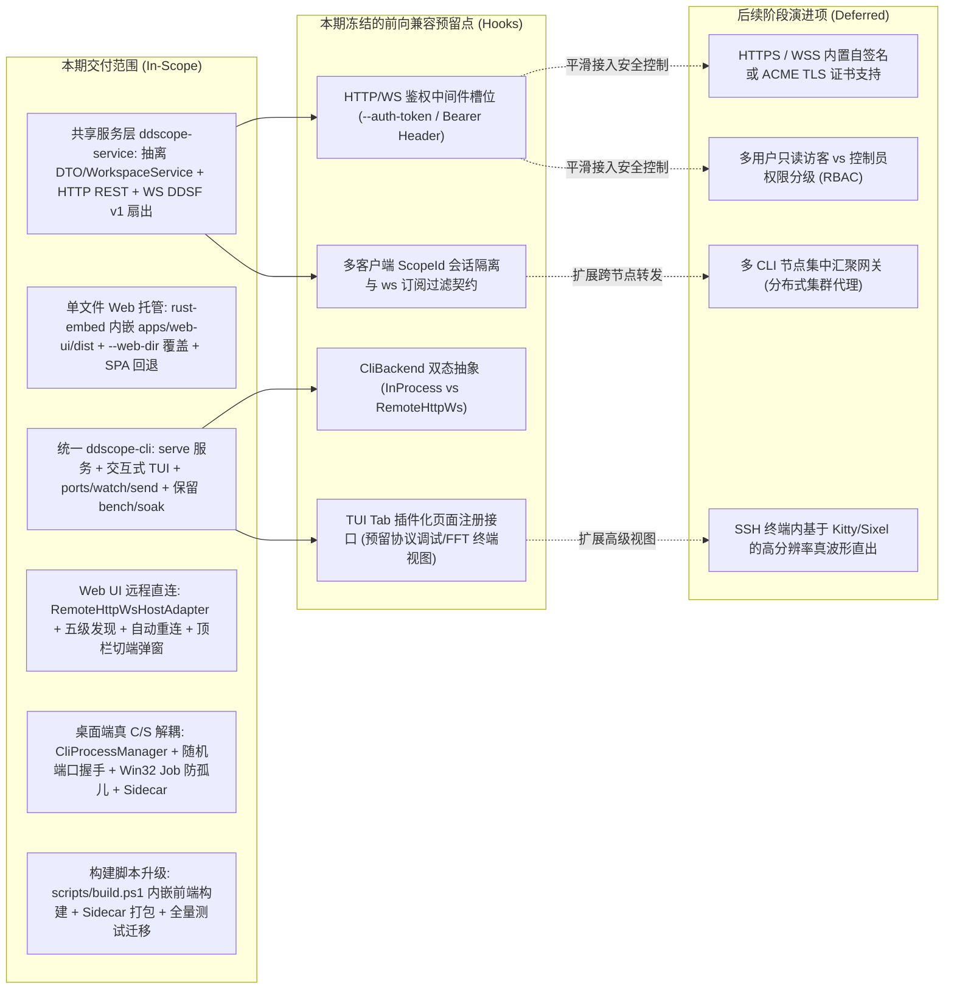
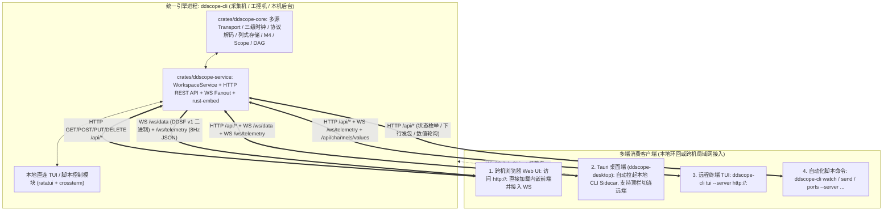
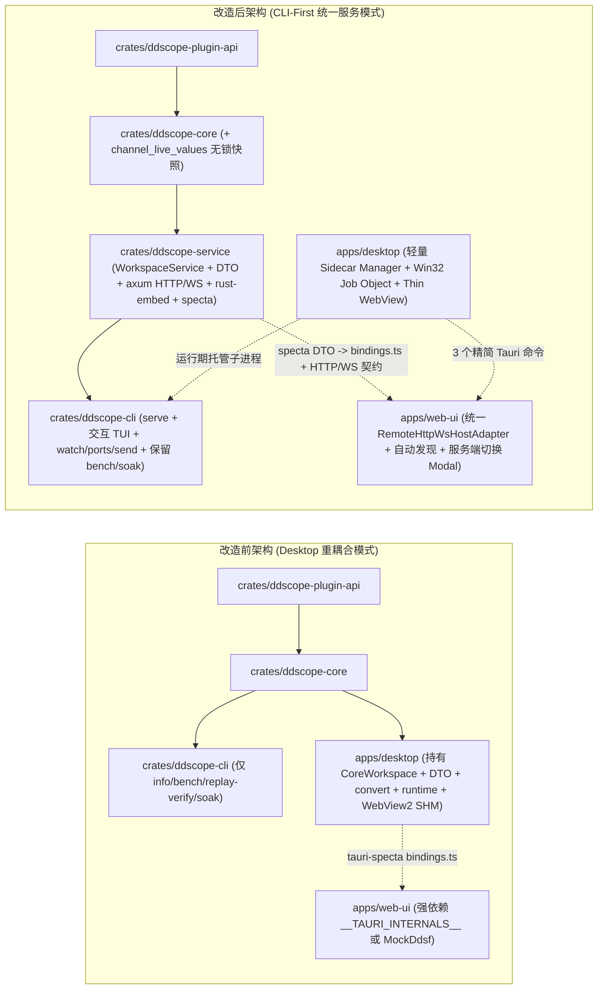
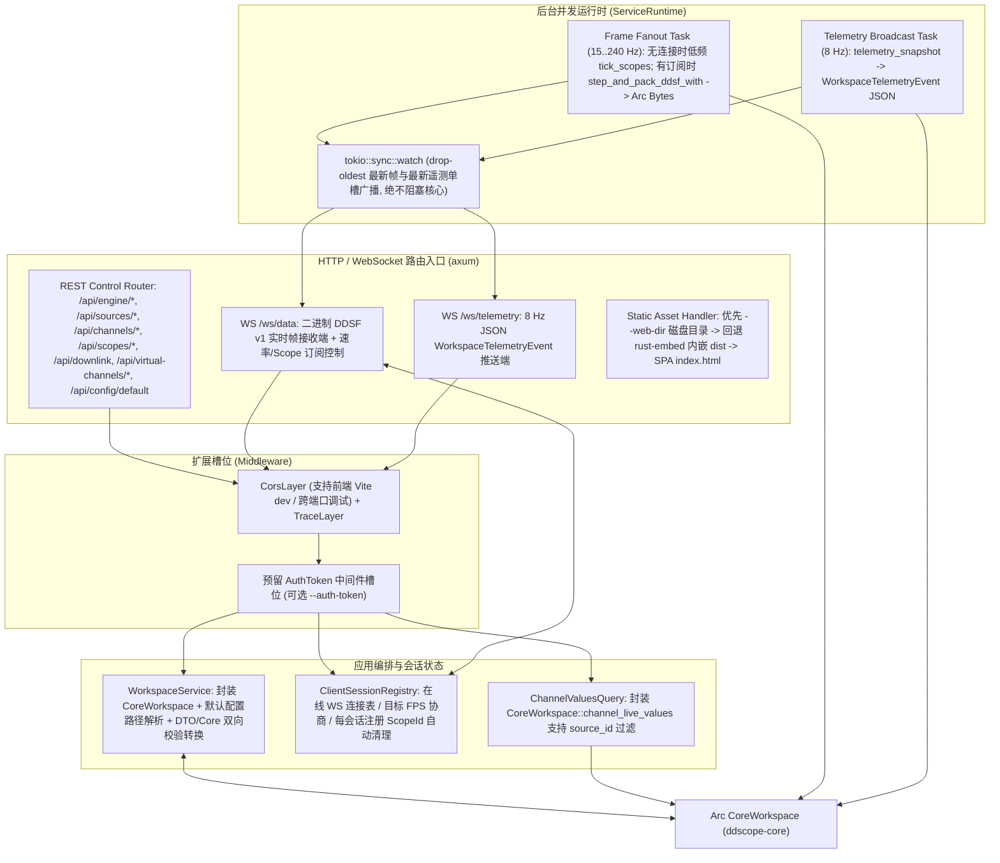
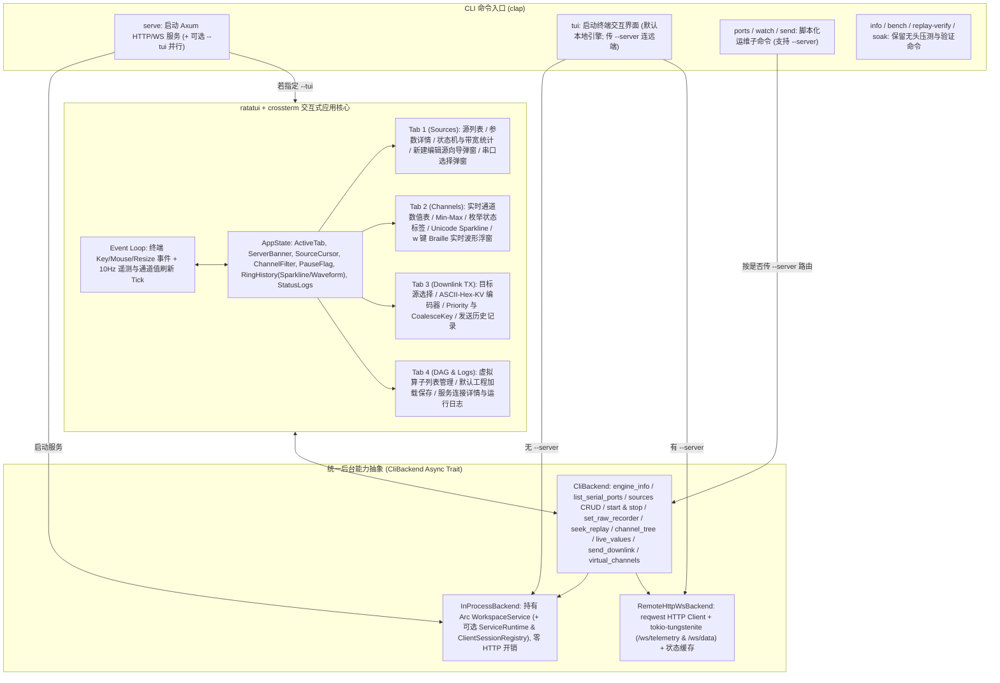
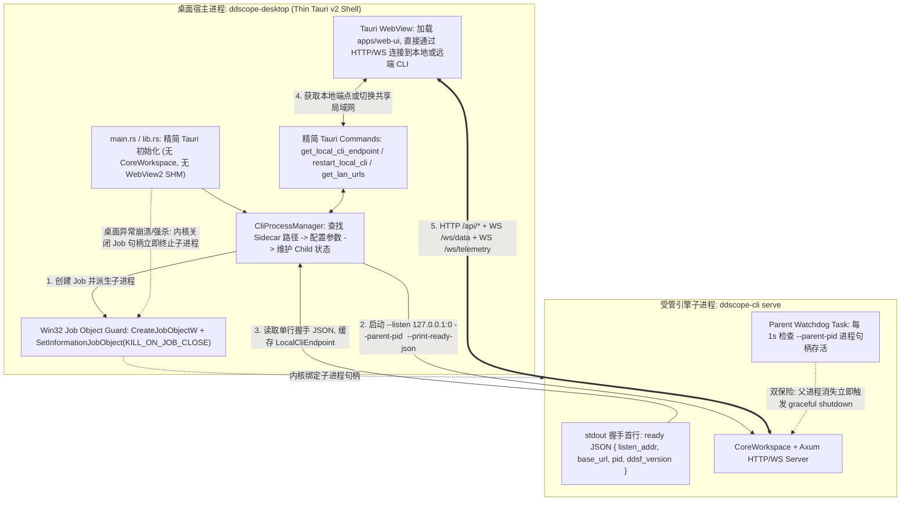
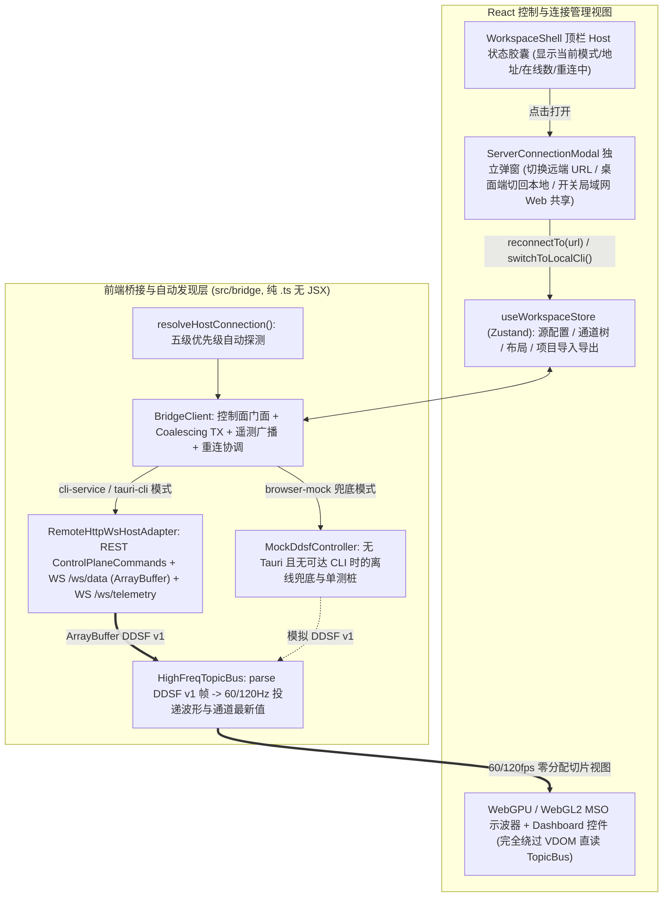
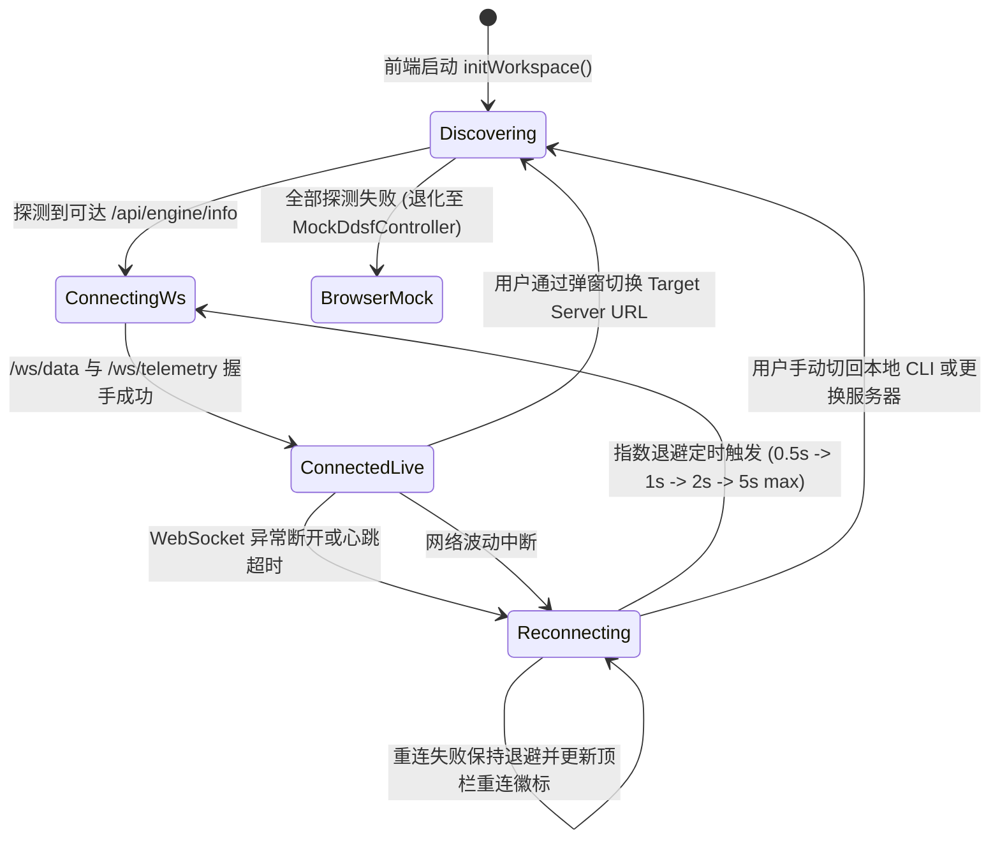
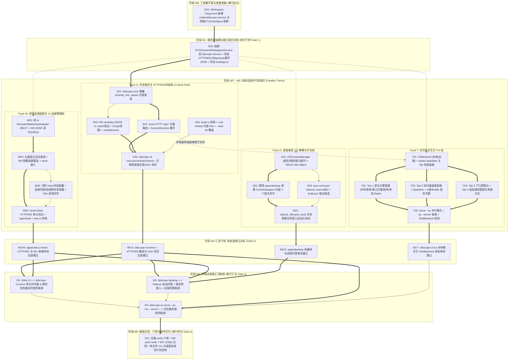
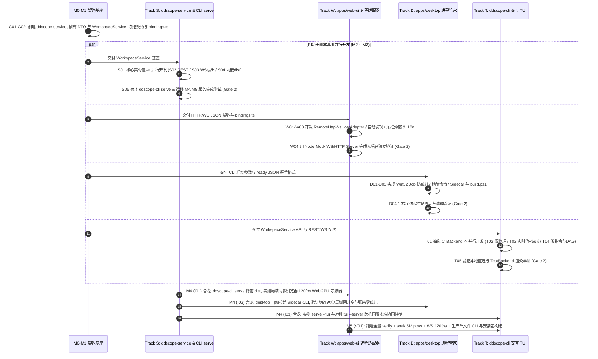

# DDScopeHost CLI 统一引擎服务、全功能 TUI 与真·C/S 跨端架构设计及开发实施计划

> **阶段定位**：架构升级 — CLI-First 统一引擎服务、全功能终端交互（TUI）与跨端真·C/S 解耦  
> **核心理念**：`ddscope-cli` 成为系统的**唯一核心采集与计算引擎进程**；无论 Web 浏览器、Tauri 桌面客户端还是远程终端，全部退化/解耦为消费同一套 HTTP/WS 服务协议的轻量客户端。即使完全脱离图形界面，通过 CLI/TUI 亦可独立完成选引擎、管数据源、实时看值、下发指令、录包与虚拟通道管理等全部核心能力。  
> **已锁定关键架构决策**：  
> - **决策 A1（桌面端真·C/S 进程解耦）**：`apps/desktop`（`ddscope-desktop`）不再进程内持有 `CoreWorkspace`；启动时自动拉起并守护本地 `ddscope-cli serve` Sidecar 进程，前端统一走 HTTP + WebSocket，同时支持在顶栏一键切换连接任意局域网/远端 CLI 服务，或对外开启局域网 Web 访问。  
> - **决策 A2（单文件内嵌前端 + 目录覆盖）**：`ddscope-cli` 默认通过 `rust-embed` 将 `apps/web-ui/dist` 编译内嵌进单个可执行文件，拷贝单个 `ddscope-cli.exe` 即可开箱即用提供完整 Web UI 服务；同时保留 `--web-dir <PATH>` 命令行参数用于开发调试与前端热替换覆盖。

---

## 目录

1. [需求拆解与范围界定](#1-需求拆解与范围界定)
   - 1.1 [核心定位重塑与范围边界（In-Scope vs. Deferred）](#11-核心定位重塑与范围边界in-scope-vs-deferred)
   - 1.2 [功能需求拆解矩阵（FR）](#12-功能需求拆解矩阵fr)
   - 1.3 [非功能与性能可靠性指标（NFR）](#13-非功能与性能可靠性指标nfr)
2. [总体架构与系统结构图 / 框架图](#2-总体架构与系统结构图--框架图)
   - 2.1 [系统全景拓扑与四种运行形态架构图](#21-系统全景拓扑与四种运行形态架构图)
   - 2.2 [Monorepo Crate 依赖演进对比图](#22-monorepo-crate-依赖演进对比图)
   - 2.3 [共享服务层内部框架图（ddscope-service）](#23-共享服务层内部框架图ddscope-service)
   - 2.4 [CLI 双模式后端与 TUI 组件框架图（ddscope-cli）](#24-cli-双模式后端与-tui-组件框架图ddscope-cli)
   - 2.5 [桌面端 Sidecar 托管与防孤儿守护框架图（apps/desktop）](#25-桌面端-sidecar-托管与防孤儿守护框架图appsdesktop)
   - 2.6 [前端跨宿主适配与连接发现框架图（apps/web-ui）](#26-前端跨宿主适配与连接发现框架图appsweb-ui)
3. [核心子系统详细技术方案](#3-核心子系统详细技术方案)
   - 3.1 [`ddscope-core` 轻量实时值查询接口增量](#31-ddscope-core-轻量实时值查询接口增量)
   - 3.2 [`ddscope-service` 控制面 DTO、HTTP REST 与 WebSocket 协议详规](#32-ddscope-service-控制面-dtohttp-rest-与-websocket-协议详规)
   - 3.3 [单文件前端内嵌与构建兼容性防坑机制](#33-单文件前端内嵌与构建兼容性防坑机制)
   - 3.4 [`ddscope-cli` 子命令规范与全功能 TUI 交互设计](#34-ddscope-cli-子命令规范与全功能-tui-交互设计)
   - 3.5 [`apps/web-ui` 统一远程适配器与连接管理 UI 设计](#35-appsweb-ui-统一远程适配器与连接管理-ui-设计)
   - 3.6 [`apps/desktop` 进程托管、Windows Job Object 守护与测试迁移](#36-appsdesktop-进程托管windows-job-object-守护与测试迁移)
   - 3.7 [`scripts/build.ps1` 构建流水线调整方案](#37-scriptsbuildps1-构建流水线调整方案)
4. [开发步骤规划、串并联依赖关系与开发流程图](#4-开发步骤规划串并联依赖关系与开发流程图)
   - 4.1 [工程解耦策略：契约先行与四轨并行](#41-工程解耦策略契约先行与四轨并行)
   - 4.2 [开发阶段划分（M0 ~ M5）与并行轨道定义](#42-开发阶段划分m0--m5与并行轨道定义)
   - 4.3 [开发主流程图（前后关系、依赖关系与串并联拓扑）](#43-开发主流程图前后关系依赖关系与串并联拓扑)
   - 4.4 [多轨协同开发与汇合联调时序图](#44-多轨协同开发与汇合联调时序图)
   - 4.5 [WBS 开发步骤与依赖关系详表](#45-wbs-开发步骤与依赖关系详表)
5. [里程碑验收标准（DoD）与技术风险预案](#5-里程碑验收标准dod与技术风险预案)
   - 5.1 [阶段门禁与场景化验收清单（DoD）](#51-阶段门禁与场景化验收清单dod)
   - 5.2 [关键技术风险与缓解预案](#52-关键技术风险与缓解预案)

---

## 1. 需求拆解与范围界定

### 1.1 核心定位重塑与范围边界（In-Scope vs. Deferred）

当前代码基线中，`ddscope-core` 的真实采集编排（`CoreWorkspace`）、DTO 转换（`apps/desktop/src/commands/`）与运行时循环（`apps/desktop/src/runtime.rs`）全部耦合在 Tauri 桌面端二进制中；而 `crates/ddscope-cli/src/main.rs` 仅承担 `info`、`bench`、`replay-verify`、`soak` 四个静态诊断/压测命令。前端 `apps/web-ui` 在脱离 Tauri 时只能回退至浏览器伪造数据源 `MockDdsfController`。

这种结构导致两个核心痛点：
1. 无法把一个轻量的采集服务端部署到工控机/树莓派/实验室主机，再从另一台电脑通过浏览器 `http://<IP>:<PORT>` 跨机查看实时波形和监控面板；
2. 无图形界面环境（SSH 终端、Linux Headless 工控机）无法正常使用产品功能（选择协议引擎、建源、启停串口、实时查看通道值、发送指令与录包）。

本次架构升级确立 **CLI-First 统一引擎服务定位**，明确本期交付范围、前向兼容预留点与后续演进边界如下：



### 1.2 功能需求拆解矩阵（FR）

| 需求编号 | 所属模块 | 需求名称 | 详细功能规格 | 优先级 |
| :--- | :--- | :--- | :--- | :--- |
| **FR-SVC-01** | `ddscope-service` | 控制面下沉与单一类型真源 | 将 [dto.rs](file:///d:/work/AI/proj/DDScopeHost/apps/desktop/src/commands/dto.rs)、[convert.rs](file:///d:/work/AI/proj/DDScopeHost/apps/desktop/src/commands/convert.rs)、[state.rs](file:///d:/work/AI/proj/DDScopeHost/apps/desktop/src/commands/state.rs) 的纯 Rust DTO 与 `WorkspaceService` 迁入 `crates/ddscope-service`，并继续由 `specta` 导出至 [bindings.ts](file:///d:/work/AI/proj/DDScopeHost/apps/web-ui/src/bridge/bindings.ts) | P0 |
| **FR-SVC-02** | `ddscope-core` | 通道实时值无锁快照接口 | 在 `CoreWorkspace` 新增 `channel_live_values()`，基于 `ChannelEntry::latest_value()` 原子读出全量/按源过滤的最新值、纳秒时间戳、模态及样本计数，不加存储写锁 | P0 |
| **FR-SVC-03** | `ddscope-service` | 全量 HTTP REST 控制面 (`/api/*`) | 提供覆盖原 28 项控制命令的 RESTful 接口 + `GET /api/health`、`GET /api/server/info`、`GET /api/channels/values`，错误响应统一返回 `ApiErrorDto { code, message }` 与标准 HTTP 状态码 | P0 |
| **FR-SVC-04** | `ddscope-service` | WebSocket 二进制帧与遥测扇出 | `GET /ws/data` 以 60/120 Hz 按客户端连接状态动态打包原生 `DDSF v1` 二进制帧并采用 drop-oldest 扇出；`GET /ws/telemetry` 按 8 Hz 推送 `WorkspaceTelemetryEvent` JSON | P0 |
| **FR-SVC-05** | `ddscope-service` | 单文件静态前端托管与覆盖 | 使用 `rust-embed` 内嵌 `apps/web-ui/dist`，支持 `--web-dir <PATH>` 优先级覆盖、`--no-web` 禁用，并对前端路由执行 SPA `index.html` 回退 | P0 |
| **FR-SVC-06** | `ddscope-service` | 多客户端并发与 Scope 隔离 | 支持多个 Web UI、桌面端与远端 TUI 同时连接同一个 CLI 实例共享数据源/通道；支持 WS 会话按注册 `scope_id` 子集过滤 `DDSF v1` 块与断线自动清理 | P1 |
| **FR-CLI-01** | `ddscope-cli` | 统一引擎后台服务模式 (`serve`) | 支持 `ddscope-cli serve --listen 0.0.0.0:8080`；支持 `--quota-mib`、`--fps`、`--config <proj.json>`、`--auto-start-sim`、`--no-web`、`--web-dir`、`--tui`、`--parent-pid`、`--print-ready-json` | P0 |
| **FR-CLI-02** | `ddscope-cli` | 脚本化运维子命令（支持远端） | 新增 `ports`（列出本机或远端串口）、`watch`（终端定时打印或 `--csv` 导出实时通道值）、`send`（向指定源下发 ASCII/Hex/KV 指令），均支持 `--server <URL>` | P1 |
| **FR-CLI-03** | `ddscope-cli` | 原有基准与验证命令零破坏 | 完整保留现有 `info`、`bench`、`replay-verify`、`soak` 子命令与参数行为，作为无头吞吐门禁与核心回归手段 | P0 |
| **FR-CLI-04** | `ddscope-cli` | 默认工程配置与状态持久化 | 延续 `ddscope.default-project.json` 便携路径语义（存放于 CLI 进程同目录或 `--config` 指定路径），由服务启动时可选自动加载，前端保存默认工程直接写入服务端磁盘 | P1 |
| **FR-TUI-01** | `ddscope-cli` (TUI) | 双模式透明运行 (`local` / `--server`) | 基于统一异步 trait `CliBackend`，支持 `ddscope-cli tui`（直连内置引擎）、`ddscope-cli serve --tui`（开服务并同终端交互）、`ddscope-cli tui --server http://ip:port`（远程连端） | P0 |
| **FR-TUI-02** | `ddscope-cli` (TUI) | Tab 1: 引擎与数据源全生命周期管理 | 源列表查看与详细信息展示；交互式弹窗表单新建/编辑源，完整支持选择传输类型（`Sim`/`Serial`+实时扫串口/`UDP`/`TCP Client`/`TCP Server`/`RawFileReplay`）、协议（`SimPreset`/`JustFloat`/`JustTyped`/`FireWater`/`FixedSchemaBinary`）、时钟（`Tier1`/`Tier2`/`Tier3`/`ChannelCounter`），支持启停、删源、`.ddraw` 录包开关与回放 Seek | P0 |
| **FR-TUI-03** | `ddscope-cli` (TUI) | Tab 2: 实时通道数值监控与终端波形 | 10~20 Hz 刷新通道最新值、单位、Min/Max、采样计数与状态机枚举名；支持 `/ ` 搜索过滤、按源筛选、Space 冻结读数、内置 Unicode Sparkline 趋势条，以及按 `w` 弹出 Braille 点阵字符实时示波小窗 | P0 |
| **FR-TUI-04** | `ddscope-cli` (TUI) | Tab 3: 下行指令发送控制台 | 支持选择目标数据源、切换 `ASCII` / `Hex` / `Key=Value` 负荷模式、配置 `Priority` 与 `coalesce_key`、查看立即回执 (`accepted` / `coalesced_existing`) 与最近发射历史重发 | P1 |
| **FR-TUI-05** | `ddscope-cli` (TUI) | Tab 4: 虚拟通道 DAG 与实时日志 | 列举当前虚拟算子节点（Formula / WindowStats / SinglePhasePower 等）、支持启用停用与删除；展示系统状态日志与在线 HTTP/WS 客户端信息 | P1 |
| **FR-WEB-01** | `apps/web-ui` | 统一 HTTP/WS 宿主适配器 | 在 [control-client.ts](file:///d:/work/AI/proj/DDScopeHost/apps/web-ui/src/bridge/control-client.ts) 接入 `RemoteHttpWsHostAdapter`，所有控制命令走 `/api/*`，`/ws/data` 二进制流直喂 `HighFreqTopicBus.ingestFrame()`，100% 复用现有 WebGPU 示波器与全部控件 | P0 |
| **FR-WEB-02** | `apps/web-ui` | 五级自动发现与断线指数重连 | 按 `?server=` -> Tauri `get_local_cli_endpoint` -> `localStorage` 记忆（桌面端） -> 同源 `/api/engine/info` -> `browser-mock` 自动识别宿主；WS 断线后指数退避自动重连并同步最新源与通道树 | P0 |
| **FR-WEB-03** | `apps/web-ui` | 顶栏连接状态切换与局域网共享界面 | 在 [WorkspaceShell.tsx](file:///d:/work/AI/proj/DDScopeHost/apps/web-ui/src/workspace/WorkspaceShell.tsx) 顶栏点击 Host 胶囊打开独立连接弹窗：输入任意 `http://<IP>:<PORT>` 切换服务端、桌面端一键切回本地 CLI、开关局域网 Web 共享并显示可复制访问地址；严格保持 [i18n/index.ts](file:///d:/work/AI/proj/DDScopeHost/apps/web-ui/src/i18n/index.ts) 双语键完全对齐 | P1 |
| **FR-DSK-01** | `apps/desktop` | CLI 子进程自动拉起与随机端口握手 | 启动时依次探测 `DDSCOPE_CLI_PATH` -> 同目录 `ddscope-cli.exe` -> `target/debug/ddscope-cli.exe`，以 `--listen 127.0.0.1:0 --no-web --parent-pid <pid> --print-ready-json` 启动并解析 stdout 首行 JSON 就绪凭据 | P0 |
| **FR-DSK-02** | `apps/desktop` | Windows Job Object 防孤儿与串口零残留 | Windows 使用 Win32 Job Object (`JOB_OBJECT_LIMIT_KILL_ON_JOB_CLOSE`) 绑定子进程句柄；CLI 侧配合 `--parent-pid` 心跳看门狗，即使被任务管理器强杀，1 秒内释放所有串口与文件句柄 | P0 |
| **FR-DSK-03** | `apps/desktop` | 桌面壳精简与局域网共享开关 | 剥离 `apps/desktop` 进程内采集与 WebView2 SHM 逻辑，仅保留 `get_local_cli_endpoint`、`restart_local_cli`、`get_lan_urls`；`tauri.conf.json` 配置 `externalBin` 将 CLI 作为 Sidecar 随 MSI/NSIS 一并打包 | P0 |
| **FR-BLD-01** | `scripts/build.ps1` | 内嵌前端与 Sidecar 联动构建流 | 编译 Release `ddscope-cli.exe` 前自动执行 `pnpm build:ui`；构建 `ddscope-desktop` 前先就绪 Sidecar `ddscope-cli.exe` 并拷贝至目标平台外部二进制路径 | P0 |
| **FR-BLD-02** | `crates/ddscope-service` | 无 `dist` 容错构建守卫 | 在 `build.rs` 中检查 `apps/web-ui/dist/index.html` 是否存在；未构建前端时编译内置诊断引导页而不阻塞纯 Rust 开发期 `cargo test --workspace` | P0 |

### 1.3 非功能与性能可靠性指标（NFR）

| 指标维度 | 目标基线值 | 验证手段与门禁要求 |
| :--- | :--- | :--- |
| **核心引擎采集吞吐** | `CoreWorkspace` 维持 **≥ 5,000,000 点/秒**（多源混合信号零丢包，无全局锁竞争） | `ddscope-cli soak --duration-secs 30 --verify-dod` 与原有核心单测全部通过 |
| **WebSocket 数据面帧率** | 本机环回与百兆/千兆局域网下，`/ws/data` 推送原生 `DDSF v1` 稳定维持 **60 / 120 fps**，单帧序列化零二次转 JSON 开销 | 服务端基准测试 + Chrome/WebView2 实时 `dataPlaneMetrics.ddsfFps` 监控 |
| **慢客户端防反压隔离** | 当某一跨机浏览器网络拥塞或暂停读取时，底层 `tokio::sync::watch` 仅覆盖最新帧（drop-oldest），绝不阻塞 `CoreWorkspace` 采集线程，服务端 RSS 不随慢连接线性增长 | 模拟阻塞接收端压测，验证高速采集丢包数为 0 且服务端内存平稳 |
| **TUI 终端渲染与 CPU 开销** | 10~20 Hz 终端表格与 Sparkline 刷新下，单核 CPU 占用 **< 5%**，串口扫描与键盘响应延迟 **< 30 ms** | `ddscope-cli tui` 挂载 2 MHz `sim0` 连续运行观测 |
| **孤儿进程零残留** | 桌面端正常关闭或被强杀（`TerminateProcess` / 任务管理器结束任务）后，**1 秒内**子进程 `ddscope-cli.exe` 自动退出并释放占用串口 | Windows 自动化进程强杀测试 + 串口重新打开验证 |
| **测试契约与向后兼容** | 原有 `apps/desktop/tests/*` 全部资产迁入 `ddscope-service` 后 **100% 绿灯**；前端 `pnpm typecheck` 与 `pnpm test:ui`（纯 `.ts` 无 JSX，含 `i18n` 键对齐） **100% 绿灯** | `cargo clippy --workspace --all-targets -- -D warnings` + `cargo test --workspace` + `pnpm test:ui` |

---

## 2. 总体架构与系统结构图 / 框架图

### 2.1 系统全景拓扑与四种运行形态架构图



**四种典型运行形态速查**：

| 运行形态 | 启动方式 | 数据路径 | 适用场景 |
| :--- | :--- | :--- | :--- |
| **形态 A：纯终端采集与监控** | `ddscope-cli tui` 或 `ddscope-cli serve --tui` | 进程内 `InProcessBackend` 直调 `WorkspaceService`（零网络序列化） | SSH 远端运维、无桌面工控机现场接串口抓波查值 |
| **形态 B：单文件 Web 服务端** | `ddscope-cli serve --listen 0.0.0.0:8080` | 局域网任意电脑浏览器访问 `http://<主机IP>:8080`，内嵌静态资源 + `/ws/data` | 采集机放在设备旁，研发人员在自己工位电脑/平板看高速示波器 |
| **形态 C：桌面端开箱即用** | 双击 `ddscope-desktop.exe` | 桌面端自动拉起 Sidecar `ddscope-cli serve --listen 127.0.0.1:0`，本机 HTTP/WS 直连 | 常规单机桌面应用体验，无后台残留，且支持一键切连远端设备或开放局域网共享 |
| **形态 D：远程终端联动** | `ddscope-cli tui --server http://<IP>:8080` | `RemoteHttpWsBackend` 接入远端服务 | 多人协同或运维侧从自己电脑终端查看已运行服务的实时通道与下发指令 |

### 2.2 Monorepo Crate 依赖演进对比图



### 2.3 共享服务层内部框架图（`ddscope-service`）



### 2.4 CLI 双模式后端与 TUI 组件框架图（`ddscope-cli`）



### 2.5 桌面端 Sidecar 托管与防孤儿守护框架图（`apps/desktop`）



### 2.6 前端跨宿主适配与连接发现框架图（`apps/web-ui`）



---

## 3. 核心子系统详细技术方案

### 3.1 `ddscope-core` 轻量实时值查询接口增量

当前 [hub.rs](file:///d:/work/AI/proj/DDScopeHost/crates/ddscope-core/src/storage/hub.rs#L171-L201) 中，`ChannelEntry` 已经通过原子变量维护无锁 `latest_value(&self) -> Option<(TimestampNs, f64)>`。目前该原子值主要被 `DdsfFramePacker` 使用，尚无直接面向控制面/TUI/HTTP 的结构化读取方法。

本次仅在 `crates/ddscope-core/src/workspace.rs` 新增零侵入只读查询，不改变任何写入热路径：

- **新增结构体 `ChannelLiveValue`**：
  - `channel_id: u32`
  - `source_id: String`
  - `full_path: String`
  - `display_name: String`
  - `unit: Option<String>`
  - `modality: ChannelKindSummary`（或复用 `ChannelDescriptor` 元数据字段：`Scalar` / `DigitalBool` / `StateMachine` / `Frame` / `EventLog`）
  - `latest_timestamp_ns: Option<u64>`
  - `latest_value: Option<f64>`
  - `state_label: Option<String>`（若为状态枚举通道，根据描述符里的状态码映射表直接查出状态名称，避免 TUI 与脚本侧重复实现解析逻辑）
  - `total_samples: u64`
- **新增方法 `CoreWorkspace::channel_live_values(&self, source_filter: Option<&SourceId>) -> Vec<ChannelLiveValue>`**：
  - 按通道注册顺序读取原子最新值与通道元信息，单次调用耗时保持在数十微秒量级，可安全支撑 TUI 20 Hz 刷屏与脚本 `ddscope-cli watch` 轮询。

### 3.2 `ddscope-service` 控制面 DTO、HTTP REST 与 WebSocket 协议详规

#### 1) 从 `apps/desktop` 抽离到 `crates/ddscope-service` 的核心模块
- `dto.rs` & `convert.rs`：剥离 `tauri_specta::Event` 属性宏（保留 `serde::{Serialize, Deserialize}` 与 `specta::Type`），实现纯正的 Tauri 无关共享契约定义；
- `state.rs`：`WorkspaceService`（由原 `DesktopBridgeState` 演进），去掉对 `tauri::State`、`WebviewWindow` 与 `ZeroCopyDataBridge`（WebView2 SHM）的耦合，直接管理 `Arc<CoreWorkspace>`、`ServiceConfig`（配额/初始源/便携配置文件目录）以及目标数据面 FPS；
- `runtime.rs`：`ServiceRuntime` 托管两个共享后台异步任务（60/120 Hz `DDSF v1` `watch` 帧生产器、8 Hz 遥测 `watch` 广播器），并提供与客户端数量关联的按需激活逻辑（无 WS 连接且无本地 TUI 订阅时自动降低帧打包频率，仅维持低频触发器推进 `tick_scopes`）；
- `server.rs`：`axum` HTTP + WebSocket 服务器构建器与生命周期控制（支持绑定 `127.0.0.1:0` 返回真实监听 `SocketAddr`）。

#### 2) HTTP REST 控制面端点清单

所有 JSON 请求/响应体 **100% 复用原 DTO 字段命名**（即与 [bindings.ts](file:///d:/work/AI/proj/DDScopeHost/apps/web-ui/src/bridge/bindings.ts) 类型契约一致），降低前端适配器维护成本：

| 分类 | Method & Path | 请求体 / 查询参数 | 响应 DTO / 类型 | 原命令映射 / 新增 |
| :--- | :--- | :--- | :--- | :--- |
| 健康与元信息 | `GET /api/health` | - | `{ ok, pid, uptime_ms }` | 新增 |
| | `GET /api/engine/info` | - | `EngineStatusDto` | `get_engine_info` |
| | `GET /api/server/info` | - | `ServerInfoDto` (`listen_addr`, `lan_urls`, `ws_data_clients`, `ws_telemetry_clients`, `target_fps`, `quota_limit_bytes`) | 新增 |
| 硬件与数据源 | `GET /api/serial-ports` | - | `Vec<SerialPortInfoDto>` | `list_serial_ports` |
| | `GET /api/sources/configs` | - | `Vec<CreateSourceRequestDto>` | `get_source_configs` |
| | `POST /api/sources` | `CreateSourceRequestDto` | `SourceSummaryDto` | `create_source` |
| | `PUT /api/sources/{source_id}` | `CreateSourceRequestDto` | `SourceSummaryDto` | `update_source` |
| | `DELETE /api/sources/{source_id}` | - | `null` (`200 OK`) | `remove_source` |
| | `POST /api/sources/{source_id}/start` | - | `SourceSummaryDto` | `start_source` |
| | `POST /api/sources/{source_id}/stop` | - | `SourceSummaryDto` | `stop_source` |
| | `POST /api/sources/{source_id}/replay/seek` | `SeekReplayRequestDto` (可省略路径冗余 `source_id`) | `null` | `seek_replay_source` |
| | `POST /api/sources/{source_id}/recorder` | `RawRecorderRequestDto` | `SourceSummaryDto` | `set_raw_recorder` |
| 通道与数值 | `GET /api/channels/tree` | - | `ChannelTreeSnapshotDto` | `get_channel_tree` |
| | `GET /api/channels/values` | `?source_id=<id>` (可选) | `ChannelLiveValuesSnapshotDto` | 新增（供 TUI / `watch`） |
| | `GET /api/run-boundaries` | - | `Vec<f64>` | `get_run_boundaries` |
| 示波器与同步 | `PUT /api/scopes/{scope_id}` | `ScopeViewportConfigDto` (+ 可选 `session_id` 查询或 Header) | `ScopeViewportSummaryDto` | `upsert_scope_viewport` |
| | `DELETE /api/scopes/{scope_id}` | - | `null` | `remove_scope_viewport` |
| | `POST /api/scopes/{scope_id}/rearm` | - | `null` | `rearm_scope` |
| | `POST /api/sync-groups` | `SyncGroupUpdateDto` | `null` | `update_sync_group` |
| 下行指令 | `POST /api/downlink` | `SendDownlinkRequestDto` | `DownlinkReceiptDto` | `send_downlink` |
| 虚拟通道 DAG | `GET /api/virtual-channels` | - | `Vec<VirtualNodeConfigDto>` | `list_virtual_channels` |
| | `PUT /api/virtual-channels` | `VirtualNodeConfigDto` | `VirtualNodeSummaryDto` | `upsert_virtual_channel` |
| | `DELETE /api/virtual-channels/{node_id}` | - | `bool` | `remove_virtual_channel` |
| | `DELETE /api/virtual-channels` | - | `u32` | `clear_virtual_channels` |
| 默认工程配置 | `GET /api/config/default` | - | `Option<String>` (`{ config_json }` 或直接 JSON 兼容) | `load_default_project_config` |
| | `PUT /api/config/default` | `{ config_json: string }` | `{ saved_path: string }` | `save_default_project_config` |
| | `DELETE /api/config/default` | - | `bool` | `clear_default_project_config` |
| 数据面节拍 | `GET /api/data-bridge/stats` | - | `DataBridgeStatsDto` | `get_data_bridge_stats` |
| | `POST /api/data-bridge/rate` | `{ rate_hz: number }` | `u32` | `set_data_bridge_rate` |

**错误状态码映射规范**（统一响应 JSON：`ApiErrorDto { code, message }`）：
- `INVALID_CONFIG` ➔ `400 Bad Request`
- `SOURCE_NOT_FOUND` / `SCOPE_NOT_FOUND` / `CHANNEL_NOT_FOUND` ➔ `404 Not Found`
- `SOURCE_ALREADY_EXISTS` ➔ `409 Conflict`
- `QUOTA_EXCEEDED` ➔ `507 Insufficient Storage`
- `NOT_IMPLEMENTED` / `UNSUPPORTED` ➔ `501 Not Implemented`
- 其余内部或 IO/传输错误 ➔ `500 Internal Server Error`

#### 3) WebSocket 实时数据面与多客户端 Scope 隔离机制
- **`GET /ws/data`**：
  - 服务端下行：每帧直接发送 WebSocket `Binary` 消息，消息体即原生 64 字节对齐 `DDSF v1` 字节切片，前端 `ZeroCopy` 解析路径无需修改格式定义。
  - 反压控制：服务端使用 `tokio::sync::watch::Sender<Option<Arc<Bytes>>>`；每个 WS 连接循环读取 `rx.changed().await` 并在有新帧时发送最新 `Arc<Bytes>`。如果某个浏览器的消费速率跟不上 120 Hz，中间错过的帧会被 `watch` 槽位自然覆盖，消除内存堆积与对采集内核的反压。
  - 客户端上行控制文本消息（JSON）：
    - `{"type":"set_rate","fps":60}`：调节目标打包帧率（钳位于 `15..=240 Hz`）；
    - `{"type":"register_session","client_id":"<uuid>","scope_ids":[1001,1002]}`：关联当前 WS 连接持有的示波器视口 ID 集合，当该 WS 断开超过宽限期（如 5 秒未重连），服务端自动调用 `CoreWorkspace::remove_scope` 清理这些遗留 `scope_id`，防止无效的视口触发与 `Chunk Pinning` 长期占满内存；
    - `{"type":"ping","ts":1700000000}` -> 回复 `{"type":"pong","ts":...}`。
- **`GET /ws/telemetry`**：
  - 每 `125 ms`（8 Hz）向所有连接端发送 `Text` JSON 帧（`WorkspaceTelemetryEvent`），包含所有数据源吞吐、连接状态以及全局 RAM 配额/Pinned 占用。

#### 4) TypeScript 契约导出迁延
- 将原 `apps/desktop/tests/export_bindings.rs` 迁入 `crates/ddscope-service/tests/export_bindings.rs`。
- 在 `crates/ddscope-service` 中，使用 `specta`（脱离 `tauri-specta`）向 [apps/web-ui/src/bridge/bindings.ts](file:///d:/work/AI/proj/DDScopeHost/apps/web-ui/src/bridge/bindings.ts) 导出全部 DTO TypeScript 类型定义；对于少数只在 `tauri` 壳保留的本机宿主命令（`get_local_cli_endpoint`、`restart_local_cli`、`get_lan_urls`），在桌面端保留独立或附属于轻量壳的类型定义，彻底消除 DTO 双端漂移风险。

### 3.3 单文件前端内嵌与构建兼容性防坑机制

为了兼顾「拷贝单个 `ddscope-cli.exe` 即可提供完整 Web UI」的便携需求与「后端/Core 开发者不构建前端也能直接 `cargo test`」的研发体验，采用双层保护机制：

1. **资源解析优先级**：
   - 若启动时传 `--no-web`，跳过静态资源路由，仅暴露 `/api/*` 与 `/ws/*`（供桌面端 Sidecar 模式使用，避免内部端口无意义暴露文件路由）；
   - 若传入 `--web-dir <PATH>`，使用 `tower_http::services::ServeDir` + `ServeFile(<PATH>/index.html)` 挂接外部磁盘目录，支持前端构建后即时刷新或开发联调；
   - 默认模式读取 `rust-embed` 内嵌资源，匹配 MIME 类型（`mime_guess`），对于未命中扩展名的 SPA 前端路径（非 `/api/*`、非 `/ws/*`）自动回退至内嵌 `index.html`。
2. **`build.rs` 无 `dist` 容错机制**：
   - 如果直接指向尚未生成 `apps/web-ui/dist` 的仓库路径去编译 `#[derive(RustEmbed)] #[folder = "../../apps/web-ui/dist"]`，在某些洁净环境（未跑 `pnpm build:ui`）下会直接报编译错误；
   - 解决方式：在 `crates/ddscope-service/build.rs` 检查 `../../apps/web-ui/dist/index.html`（并声明 `cargo:rerun-if-changed=...`）。当存在真实前端产物时启用真实目录内嵌；当不存在时生成轻量嵌入式占位资源目录并输出提示页（明确告知用户运行 `pnpm build:ui` 重新编译，或启动时传入 `--web-dir`），从而保证 `cargo check` / `cargo test --workspace` 在任何无 Node 环境下均可 100% 绿灯编译。

### 3.4 `ddscope-cli` 子命令规范与全功能 TUI 交互设计

#### 1) 完整 CLI 子命令规范

| 子命令 | 核心用途与关键参数 | 运行模式 |
| :--- | :--- | :--- |
| `ddscope-cli serve` | 启动服务引擎与 HTTP/WS 服务器。<br/>参数：`--listen <0.0.0.0:8080>`、`--web-dir <PATH>`、`--no-web`、`--quota-mib <2048>`、`--fps <120>`、`--config <proj.json>`、`--auto-start-sim`、`--tui`、`--parent-pid <PID>`、`--print-ready-json` | `InProcessBackend` (+ 可选同终端启动 TUI) |
| `ddscope-cli tui` | 独立启动全功能交互式 TUI。<br/>参数：`--server <URL>`（省略则内置本机引擎）、`--quota-mib <2048>`、`--config <proj.json>`、`--auto-start-sim` | 无 `--server` 走本机引擎；传 `--server` 连远端 HTTP/WS |
| `ddscope-cli ports` | 列举当前可见串口信息（端口号、描述、VID/PID），支持 `--json` 与 `--server <URL>` | 支持本地与远端 |
| `ddscope-cli watch` | 在标准终端连续输出指定或全部通道的实时值，支持 `--server <URL>`、`--filter <前缀/子串>`、`--interval-ms <200>`、`--csv` | 支持本地与远端 |
| `ddscope-cli send` | 无头脚本化下行发送，支持 `--server <URL>`、`--source <id>`、`--ascii <txt>` / `--hex <bytes>` / `--kv <k=v>`、`--priority <high\|normal>`、`--coalesce-key <k>` | 支持本地与远端 |
| `ddscope-cli info / bench / replay-verify / soak` | 保留现有版本信息、5M pts/s 基准测试、离线文件校验与 30s 混合信号极限压测命令 | 本机 `ddscope-core` 零变化保留 |

#### 2) 交互式 TUI 布局线框图与核心操作映射

```text
┌─ DDScopeHost TUI v0.1.0 ── [LOCAL + SERVING http://192.168.1.50:8080 | Clients: 2] ── RAM: 48/2048 MiB ─┐
│ [1] 数据源与引擎 (Sources)   [2] 实时通道 (Channels)   [3] 下行发送 (TX)   [4] 虚拟通道与日志 (DAG)       │
├──────────────────────────────────────────────┬──────────────────────────────────────────────────────────┤
│ 数据源列表 (↑/↓ 选择)                         │ 当前选中源详情与即时控制                                  │
│ ● sim0   [RUN] Sim    SimPreset   2.0M S/s   │ ID: com0  显示名: STM32 FOC 控制器                        │
│ ● com0   [RUN] Serial JustFloat   10.0k S/s  │ 传输: Serial COM3 @ 921600 8N1 [自动重连: 开]             │
│ ○ udp0   [STP] Udp    FireWater      0 S/s   │ 协议: JustFloat (ch0, ch1, ch2, ch3)                     │
│ ○ file0  [CPL] Replay JustTyped      0 S/s   │ 时钟: Tier2 SoftwarePll (nominal: 10000 Hz)               │
│                                              │ 统计: RX 160.2 KB/s | 丢包: 0 | 解错: 0 | 原始录包: 关   │
├──────────────────────────────────────────────┴──────────────────────────────────────────────────────────┤
│ 实时通道数值表 (10Hz 刷新 | / 过滤 | Space 暂停读数 | w 弹出 Braille 实时波形)                           │
│ 通道路径              模态     当前值          最小         最大         迷你趋势           采样总数       │
│ com0/ch0             Scalar   +12.348 V      +11.90       +12.82       ▂▃▅▇▆▄▃▂▃▅▇▆      248,200        │
│ com0/ch1             Scalar    -0.412 A       -1.20        +1.15       ▆▄▂▁▂▄▆▇▆▄▂▁      248,200        │
│ sim0/digital/d0      Bool     HIGH (1)        0            1           ▁▁████▁▁████      4,000,000      │
│ sim0/state/fsm       State    RUN (2)         -            -           ────────────      4,000,000      │
├──────────────────────────────────────────────────────────────────────────────────────────────────────────┤
│ [1-4]切页 [n]新建源 [e]编辑 [s]启停 [d]删除 [r]录包 [t]发指令 [p]扫串口 [w]终端波形 [?]帮助 [q]退出        │
└──────────────────────────────────────────────────────────────────────────────────────────────────────────┘
```

**全功能操作弹窗设计**：
- **新建/编辑数据源表单弹窗 (`n` / `e`)**：
  - 传输类型选择器（左右键切换）：`Sim` / `Serial`（内置 `p` 快捷键即时下拉选择扫描到的串口端口与波特率）/ `Udp` / `TcpClient` / `TcpServer` / `RawFileReplay`；
  - 协议选择器：`SimPreset` / `JustFloat`（逗号分隔通道名）/ `JustTyped`（`name:f32, name2:i32, ...` 简写规则解析）/ `FireWater` / `FixedSchemaBinary`（支持加载 JSON Schema 模板或标准字段配置）；
  - 时钟同步选择器：`Tier1HardwareCounter` / `Tier2SoftwarePll` / `Tier3HostArrival` / `ChannelCounter`。
- **Braille 终端实时示波浮窗 (`w`)**：
  - 对当前高亮通道维护环形最近 `N=256` 点历史队列（本地/远端均可更新），利用 `ratatui::widgets::Canvas` + `Marker::Braille` 在终端上直接绘制自适应量程曲线与当前值/峰峰值/频率简报，无需浏览器即可在纯终端里看清波形正误。

### 3.5 `apps/web-ui` 统一远程适配器与连接管理 UI 设计

#### 1) 关键代码模块边界守卫
- **纯 `.ts` 与 `.tsx` 严格分离**：仓库中的 `pnpm test:ui` 使用 `node --test tests/*.test.ts` 原生 TypeScript Strip-Types 直接运行，不支持解析 JSX/TSX 语法。因此新增 `apps/web-ui/src/bridge/remote-service-adapter.ts` 以及改造 [control-client.ts](file:///d:/work/AI/proj/DDScopeHost/apps/web-ui/src/bridge/control-client.ts) 和 [store.ts](file:///d:/work/AI/proj/DDScopeHost/apps/web-ui/src/workspace/store.ts) **严禁导入任何 `.tsx` 组件文件**。

#### 2) 宿主自动发现决策流与断线重连状态机

**宿主连接模式定义（升级 `HostRuntimeMode`）**：
- `"tauri-cli"`：运行在桌面端 WebView 中，默认指向本地托管 `ddscope-cli`（或用户切换记住的远端 CLI）；
- `"cli-service"`：独立浏览器访问由 `ddscope-cli serve` 托管的页面，或通过 `?server=http://...` 指定的远端服务端；
- `"browser-mock"`：无桌面端且无任何可达服务端（如纯 Vite 预览、静态文件直接打开、单元测试环境）的自动降级模式。

**五级发现顺序**：
1. 检测 URL 查询参数 `?server=<URL>` -> 若存在则直接验证并使用该远程服务端；
2. 检测是否存在桌面端桥 `__TAURI_INTERNALS__` -> 调用极简 Tauri 命令 `get_local_cli_endpoint()` 获取本地 `http://127.0.0.1:<port>`（并结合用户配置决定是否直连之前绑定的远端 CLI）；
3. 若为普通浏览器打开：请求同源 `GET /api/engine/info`（由 `ddscope-cli serve` 提供服务时同源必通）；
4. 若未通但 `localStorage` 中存有上次手动连接的 `ddscope.remoteServerUrl` -> 探测该地址 `/api/health`；
5. 以上全失败 -> 自动安全回退到现有 `MockDdsfController`（保持现有纯浏览器演示与 68 项单测零破坏）。



#### 3) 顶栏连接管理弹窗 (`ServerConnectionModal.tsx`) 与双语同步
- 顶栏 [WorkspaceShell.tsx](file:///d:/work/AI/proj/DDScopeHost/apps/web-ui/src/workspace/WorkspaceShell.tsx) 中的 `Host` 状态胶囊改造为可点击按钮（显示当前模式、实际连接的服务地址以及绿/黄/灰三态指示灯）。
- 点击弹出的独立模态窗口提供：
  - 当前服务端信息展示（PID/引擎版本/当前连接端点数）；
  - 输入框切换连接任意 `http://<IP>:<PORT>` 远端 `ddscope-cli`；
  - 仅桌面端可见区：**「切回本机内置 CLI」**按钮 + **「允许局域网访问本机采集服务」**开关（触发 `restart_local_cli` 绑定 `0.0.0.0:<port>` 并展示 `http://<LAN_IP>:<port>` 列表供另一台电脑扫码/复制打开）；
  - 所有新增中文与英文文案成对同步添加至 [apps/web-ui/src/i18n/index.ts](file:///d:/work/AI/proj/DDScopeHost/apps/web-ui/src/i18n/index.ts) 的 `ZH_CN_MESSAGES` 与 `EN_MESSAGES` 中，确保参数占位符 `{url}`、`{port}` 完全一致（严格过 `tests/i18n.test.ts`）。

### 3.6 `apps/desktop` 进程托管、Windows Job Object 守护与测试迁移

#### 1) 桌面端托管 `ddscope-cli` 握手与生命周期守护
- **`CliProcessManager` 查找优先级**：
  1. 环境变量 `DDSCOPE_CLI_PATH`（方便 CI/调试指定任意构建输出）；
  2. 当前 `ddscope-desktop.exe` 同级目录的 `ddscope-cli.exe` / `ddscope-cli`（Release 独立运行与 MSI/NSIS 安装后路径）；
  3. 依据 Tauri Sidecar `externalBin` 命名约定解析（如 `ddscope-cli-x86_64-pc-windows-msvc.exe`）；
  4. 开发态回退查找工作区 `target/debug/ddscope-cli.exe`。
- **启动命令行与就绪握手**：
  - 默认启动：`ddscope-cli serve --listen 127.0.0.1:0 --no-web --parent-pid <desktop_pid> --print-ready-json`；
  - 开启局域网 Web 共享时重启：`ddscope-cli serve --listen 0.0.0.0:<lan_port> --parent-pid <desktop_pid> --print-ready-json`（自动启用内嵌 Web 托管）；
  - `ddscope-cli serve` 在 `TcpListener::bind` 成功后立即向 `stdout` 打印单行 JSON：`{"ready":true,"listen_addr":"127.0.0.1:54321","base_url":"http://127.0.0.1:54321","pid":12345}` 并 `flush()`；`CliProcessManager` 带超时等待（5 秒）解析该首行，获得确定可用端口。
- **防孤儿进程双保险**：
  - **Windows 内核级保险**：借助工作区现有 `windows-sys` crate（补充 `Win32_System_JobObjects` feature），桌面端调用 `CreateJobObjectW` + `SetInformationJobObject(JobObjectExtendedLimitInformation)` 设置 `JOB_OBJECT_LIMIT_KILL_ON_JOB_CLOSE`，在子进程创建后通过 `AssignProcessToJobObject` 纳入 Job。哪怕 `ddscope-desktop.exe` 触发崩溃或被用户从任务管理器直接结束进程树，Windows 内核会立即回收子进程并关闭所有串口、Socket 和文件句柄。
  - **跨平台看门狗双保险**：`ddscope-cli` 根据 `--parent-pid` 每秒检查父进程存活状态，父进程终止时自动执行 `CoreWorkspace::shutdown()` 并安全退出。

#### 2) 现有 `apps/desktop/tests/*` 资产精确迁移对照表

当前桌面端的 5 个核心集成测试文件中，控制面、全栈联调与 M5 DoD 验收测试高度依赖 `CoreWorkspace` 编排能力，应无缝迁移至 `crates/ddscope-service/tests/`，确保核心测试资产零丢弃、桌面端则新增进程托管专项测试：

| 原测试文件 (`apps/desktop/tests/`) | 改造后去向 | 验证重点说明 |
| :--- | :--- | :--- |
| [export_bindings.rs](file:///d:/work/AI/proj/DDScopeHost/apps/desktop/tests/export_bindings.rs) | 迁至 `crates/ddscope-service/tests/export_bindings.rs` | 改用 `specta` 导出所有共享 DTO 到 `apps/web-ui/src/bridge/bindings.ts`（并断言新增的 `ChannelLiveValueDto` / `ServerInfoDto` 等存在） |
| [td1_control_plane_tests.rs](file:///d:/work/AI/proj/DDScopeHost/apps/desktop/tests/td1_control_plane_tests.rs) | 迁至 `crates/ddscope-service/tests/control_plane_tests.rs` | 直接测试 `WorkspaceService` 28 项控制命令语义与非法配置校验；额外补充 HTTP `/api/*` REST 路由端到端契约测试 |
| [m4_fullstack_integration_tests.rs](file:///d:/work/AI/proj/DDScopeHost/apps/desktop/tests/m4_fullstack_integration_tests.rs) | 迁至 `crates/ddscope-service/tests/fullstack_ws_tests.rs` | 保留原多源/示波器/虚通道测试，并升级为通过真实 `axum` 服务对 `/ws/data` 接收验证完整 `DDSF v1` 二进制帧与 `/ws/telemetry` 事件 |
| [m5_acceptance_dod_tests.rs](file:///d:/work/AI/proj/DDScopeHost/apps/desktop/tests/m5_acceptance_dod_tests.rs) | 迁至 `crates/ddscope-service/tests/acceptance_dod_tests.rs` | 保留 M5 DoD（毛刺锁存 `Chunk Pinning`、跨源对比、内存上限公平淘汰、慢 WS 客户端抗压验证） |
| `td2_data_bridge_bench.rs` | 演进为 `crates/ddscope-service/tests/ws_fanout_bench.rs` | 剥离已废弃的 WebView2 SHM 测试，基准验证高帧率下 `tokio::sync::watch` 对多 WS 客户端扇出的延迟与吞吐 |
| **新增桌面端测试** | 新增 `apps/desktop/tests/sidecar_lifecycle_tests.rs` | 验证 `CliProcessManager` 拉起 `ddscope-cli`、读取 `ready` JSON 握手、重启切换监听模式与 Drop/Job 关闭后子进程清理 |

### 3.7 `scripts/build.ps1` 构建流水线调整方案

改造后 [scripts/build.ps1](file:///d:/work/AI/proj/DDScopeHost/scripts/build.ps1) 的编译编排逻辑调整如下（重点确保单文件 CLI 含最新 Web UI、桌面端含完整 Sidecar）：

1. **CLI 构建（Target `cli` / 菜单 `[7]`）**：
   - Release 模式下默认先调用 `Build-WebUi` 生成 `apps/web-ui/dist`，再执行 `cargo build --release -p ddscope-cli`，确保产出的单文件 `target/release/ddscope-cli.exe` 开箱内嵌最新完整网页版；
   - 支持 `-NoWebUiBuild`（或 Debug 模式跳过前端重编）以加速纯后端增量编译。
2. **桌面端及安装包构建（Target `desktop` / `bundle` / 菜单 `[1]~[5]`）**：
   - 执行链调整为：**`Build-WebUi` ➔ 编译并就绪同目标三元组 Sidecar `ddscope-cli`（复制/硬链至 `apps/desktop/binaries/ddscope-cli-<target-triple>.exe` 及同输出目录）➔ `cargo build --release -p ddscope-desktop` / `pnpm --filter @ddscope/desktop tauri build`**；
   - 保证免安装版 `target/release/ddscope-desktop.exe` 与 `.msi` / `-setup.exe` 安装包内置开箱可用的 `ddscope-cli` Sidecar。
3. **快速开发模式（Target `dev` / 菜单 `[10]`）**：
   - 启动 `pnpm dev` 前确保存在最新 Debug `ddscope-cli.exe`（或由 Vite + CLI 同时并行跑通），开发者修改后端仅需重编 CLI，无需反复全量重启前端，修改前端直接热更新。

---

## 4. 开发步骤规划、串并联依赖关系与开发流程图

### 4.1 工程解耦策略：契约先行与四轨并行

为了避免“TUI 等服务接口、Web 前端等 HTTP API、桌面端等 Sidecar 稳定后才能动工”导致的漫长串行等待，采用与 Phase 1 一脉相承的 **“契约先行、四轨独立开发、M3 各自自测达标、M4 三路汇合联调”** 策略：

1. **冻结门禁前置（M0 ~ M1）**：在两天以内率先建好 `crates/ddscope-service` 骨架，明确所有 HTTP REST 路径、WS 帧约定、`CliBackend` Trait 签名以及桌面端与 CLI 的 stdout `ready` JSON 格式，并第一时间刷新导出 [bindings.ts](file:///d:/work/AI/proj/DDScopeHost/apps/web-ui/src/bridge/bindings.ts)。
2. **各轨道独立自测桩**：
   - **Web 前端轨（Track W）**：基于精确的 HTTP/WS 契约与 Node 原生模拟 HTTP/WS 服务器，即可在零真实 Rust 服务进程下完成 `RemoteHttpWsHostAdapter`、断线重连和连接弹窗的全部开发与单测；
   - **桌面端轨（Track D）**：依据已冻结的 `serve --listen 127.0.0.1:0 --print-ready-json` 契约，可立即通过极简占位进程或早期 `serve` 二进制开发 Win32 Job Object 与 `CliProcessManager`；
   - **TUI 轨（Track T）**：依据冻结的 `CliBackend` Trait 接口定义先行实现全套 `ratatui` UI、表单与交互状态机，后端接通时直接零改动接入 `InProcessBackend` 与 `RemoteHttpWsBackend`。

### 4.2 开发阶段划分（M0 ~ M5）与并行轨道定义

整个改造与开发过程划分为 **6 个阶段（M0 ~ M5）**，核心实施阶段包含 **4 条跨团队并行轨道** 以及轨道内部的精细子任务并发：

- **阶段 M0（串行起点）：依赖与工作区脚手架准备** (`G01`)
  - 更新根 `Cargo.toml`（纳入 `crates/ddscope-service`，补充 `axum`, `tower-http`, `rust-embed`, `mime_guess`, `futures-util`, `ratatui`, `crossterm`, `reqwest`, `tokio-tungstenite` 依赖与 `windows-sys` 的 `Win32_System_JobObjects`）。
- **阶段 M1（串行门禁 Gate 1）：共享服务核抽离与全链路契约冻结** (`G02`)
  - 将 DTO、`convert.rs` 与 `WorkspaceService` 从 `apps/desktop` 迁移到 `crates/ddscope-service`，迁移 `specta` `bindings.ts` 导出测试；锁定 HTTP/WS API 规范、`CliBackend` Trait、桌面 CLI 握手 JSON 规范。
- **阶段 M2 ~ M3（四轨高度并行研发期）**：
  - **Track S（服务端网络层与内嵌宿主轨）**：
    - `S01`：`ddscope-core` 补充 `CoreWorkspace::channel_live_values()` 与单测；
    - 并行组（`S01` 完成后/`M1` 后立即并行推进）：
      - `S02`：实现 `axum` HTTP `/api/*` 全量控制面路由、错误状态码映射与 `ServiceRuntime`；
      - `S03`：实现 `/ws/data`（`watch` 扇出 `DDSF v1` + 多端 Scope 会话清理）与 `/ws/telemetry`（8 Hz JSON 扇出）；
      - `S04`：实现 `build.rs` 无 `dist` 容错守卫、`rust-embed` 内嵌静态页、`--web-dir` 覆盖与 SPA 回退；
    - `S05`（轨道合拢）：`ddscope-cli` 接入 `serve` 与 `ports`/`watch`/`send` 子命令，并把原桌面核心控制面/全栈/DoD 测试迁移并跑通为 `ddscope-service` HTTP/WS 集成测试。
  - **Track W（前端远程适配器与连接管理轨）**：
    - `W01`：编写纯 `.ts` 的 `RemoteHttpWsHostAdapter`（REST 控制面 + WS `/ws/data` 转交 `HighFreqTopicBus` + WS `/ws/telemetry`）；
    - `W02`：升级 [control-client.ts](file:///d:/work/AI/proj/DDScopeHost/apps/web-ui/src/bridge/control-client.ts) 与 [store.ts](file:///d:/work/AI/proj/DDScopeHost/apps/web-ui/src/workspace/store.ts) 支持五级宿主探测与指数退避重连；
    - `W03`（与 `W01`/`W02` 后半程可部分并行）：开发 [WorkspaceShell.tsx](file:///d:/work/AI/proj/DDScopeHost/apps/web-ui/src/workspace/WorkspaceShell.tsx) 顶栏可交互连接状态与独立远端切换/局域网共享弹窗 + 严格补齐 `i18n/index.ts` 双语词条；
    - `W04`：补充 Node HTTP/WS Mock 单元测试，保证 `pnpm typecheck` 与 `pnpm test:ui` 全绿。
  - **Track D（桌面端真·C/S 进程解耦与打包轨）**：
    - `D01`：实现 `CliProcessManager`（可执行查找、随机端口握手 JSON 读取与状态管理）与 Win32 Job Object 内核强关联防孤儿守护；
    - `D02`：剥离 `apps/desktop` 中原 `CoreWorkspace`、`runtime.rs` 重循环与 `WebView2 SharedBuffer` 逻辑，精简为 3 个壳命令；
    - `D03`（与 `D02` 可同步推进）：配置 `tauri.conf.json` Sidecar `externalBin` 并改造 [scripts/build.ps1](file:///d:/work/AI/proj/DDScopeHost/scripts/build.ps1) 构建与复制链路；
    - `D04`：编写桌面端 `sidecar_lifecycle_tests.rs` 并验证子进程拉起与防孤儿清理。
  - **Track T（全功能交互式 TUI 轨）**：
    - `T01`：定义并实现 `CliBackend`（本地 `InProcessBackend` + 远端 `RemoteHttpWsBackend`）与 `ratatui` 应用骨架、事件调度及全局导航框；
    - 并行组（`T01` 冻结框架后 3 个界面模块完全可同时并发实现）：
      - `T02`：Tab 1 数据源管理（列表、详情、新建/编辑源交互向导、串口扫描弹出选择、启停删改、录包开关、回放 Seek）；
      - `T03`：Tab 2 实时通道值监控（表格、`/` 过滤、Space 暂停、Sparkline 趋势条、`w` 键 Braille 实时波形弹窗）；
      - `T04`：Tab 3 下行控制台（`ASCII`/`Hex`/`KV`、优先级与合并键）+ Tab 4 虚拟通道管理与系统状态/日志页；
    - `T05`（轨道合拢）：打通 `ddscope-cli serve --tui` 同终端并行视图与 `ddscope-cli tui --server` 远端连接测试，编写 headless `ratatui::backend::TestBackend` 渲染回归测试。
- **阶段 M3 汇合门禁（Gate 2）**：四轨独立达标
  - `ddscope-service` + `ddscope-cli serve` 全套 HTTP/WS/DoD 测试独立绿灯；`apps/web-ui` 连接本地测试桩单测绿灯；`apps/desktop` 进程托管测试与 `ddscope-cli tui` 渲染自测各自达标。
- **阶段 M4（串行汇合联调 Gate 3）**：全系统跨端闭环联调
  - `I01`：跨浏览器实测 `ddscope-cli serve` 托管内嵌前端（不同机器访问 `http://<IP>:<PORT>` 跑通所有功能与多浏览器并行 Scope 隔离）；
  - `I02`：实测 `ddscope-desktop` Sidecar 自动启动本地 `ddscope-cli`、强杀防孤儿、切连远端服务与开启局域网共享；
  - `I03`：实测 `ddscope-cli serve --tui` 与浏览器/桌面端多端同屏同步联调（TUI 启停串口 -> Web UI 立即出波；Web UI 下发指令 -> TUI 立即感知）。
- **阶段 M5（串行收尾 Gate 4）**：全量门禁、压测加固与正式产物打包
  - `V01`：执行 `pnpm typecheck`、`pnpm test:ui`、`cargo clippy --workspace --all-targets -- -D warnings`、`cargo test --workspace`、`ddscope-cli soak`、跨端 120 fps WS 压测以及生产级单文件 CLI + 桌面安装包构建验收。

### 4.3 开发主流程图（前后关系、依赖关系与串并联拓扑）

下图中：**粗实线箭头 (`==>`) 表示决定总工期的关键路径（Critical Path）**，**常规实线箭头 (`-->`) 表示强前置依赖**，**虚线箭头 (`-.->`) 表示契约或接口规范输入**。



### 4.4 多轨协同开发与汇合联调时序图



### 4.5 WBS 开发步骤与依赖关系详表

| 任务 ID | 阶段 / 轨道 | 任务名称 | 前置依赖 | 下游解锁 | 串/并联属性 | 主要涉及文件 / 目录 | 验证与完成标准 |
| :--- | :--- | :--- | :--- | :--- | :--- | :--- | :--- |
| **G01** | M0 底座 | Workspace 工程与公共依赖升级 | 无 | G02 | **串行起点 (关键路径)** | [Cargo.toml](file:///d:/work/AI/proj/DDScopeHost/Cargo.toml), 新增 `crates/ddscope-service/Cargo.toml` | 新增 crate 被 Workspace 识别，全依赖可正常解析拉取 |
| **G02** | M1 契约 | 抽离共享服务层与冻结全链路契约 | G01 | S01, S02, S03, S04, W01, D01, T01 | **串行门禁 (关键路径)** | `crates/ddscope-service/src/{dto,convert,state,lib}.rs`, `crates/ddscope-service/tests/export_bindings.rs` | `bindings.ts` 成功导出；HTTP/WS/握手 JSON 文档化定稿 |
| **S01** | Track S | `ddscope-core` 增量 `channel_live_values()` | G02 | S02, S03 | Track S 起点 **(关键路径)** | [crates/ddscope-core/src/workspace.rs](file:///d:/work/AI/proj/DDScopeHost/crates/ddscope-core/src/workspace.rs) | 无锁读取原子最新值与状态名，带 `ddscope-core` 单元测试 |
| **S02** | Track S | `axum` REST `/api/*` 与 `ServiceRuntime` | G02, S01 | S05 | **模块内与 S03/S04 并行 (关键路径)** | `crates/ddscope-service/src/{server,routes_api,runtime}.rs` | 全量 28+3 个端点编译通过，状态码映射覆盖齐全 |
| **S03** | Track S | WS `/ws/data` + `/ws/telemetry` 与多端 Scope 隔离 | G02, S01 | S05 | **模块内与 S02/S04 并行 (关键路径)** | `crates/ddscope-service/src/{routes_ws,session}.rs` | `watch` 扇出 `DDSF v1` 帧无反压，WS 断线后自动回收注册的 Scope |
| **S04** | Track S | 单文件 `rust-embed` 内嵌、`build.rs` 与 `--web-dir` | G02 | S05 | **模块内与 S02/S03 并行** | `crates/ddscope-service/{build.rs,src/static_web.rs}` | 无 `apps/web-ui/dist` 时能安全降级编译；存在时内嵌并提供 SPA 回退 |
| **S05** | Track S | `ddscope-cli serve/ports/watch/send` 与测试大迁移 | S02, S03, S04 | G_S_OK (M3) | Track S 汇合 **(关键路径)** | [crates/ddscope-cli/src/main.rs](file:///d:/work/AI/proj/DDScopeHost/crates/ddscope-cli/src/main.rs), `crates/ddscope-service/tests/*` | `cargo test -p ddscope-service -p ddscope-cli`（含迁入的 M4/M5 DoD 测试）全通过 |
| **W01** | Track W | 纯 `.ts` `RemoteHttpWsHostAdapter` 与 WS 数据接收器 | G02 | W02 | **与 Track S/D/T 跨轨并行** | 新增 `apps/web-ui/src/bridge/remote-service-adapter.ts` | REST 调用与二进制 `ArrayBuffer` 解析进入 `HighFreqTopicBus` |
| **W02** | Track W | 五级宿主自动发现、指数退避重连与 Store 接入 | W01 | W03, W04 | Track W 主线 | [control-client.ts](file:///d:/work/AI/proj/DDScopeHost/apps/web-ui/src/bridge/control-client.ts), [store.ts](file:///d:/work/AI/proj/DDScopeHost/apps/web-ui/src/workspace/store.ts) | 启动可自动分辨 Tauri-CLI / 同源 Web / Mock，断线自动重连恢复 |
| **W03** | Track W | 顶栏连接弹窗 (`ServerConnectionModal`) 与双语更新 | W02 | W04 | 与 W02 末端紧接 | [WorkspaceShell.tsx](file:///d:/work/AI/proj/DDScopeHost/apps/web-ui/src/workspace/WorkspaceShell.tsx), [i18n/index.ts](file:///d:/work/AI/proj/DDScopeHost/apps/web-ui/src/i18n/index.ts) | 弹窗独立展示，支持输 IP 切服、切回本地、开关局域网共享；`i18n` 零报错 |
| **W04** | Track W | 前端 Mock HTTP/WS 测试补全与 `test:ui` 验收 | W02, W03 | G_W_OK (M3) | Track W 收尾 | `apps/web-ui/tests/*` | `pnpm typecheck` 与 `pnpm test:ui`（含原 68 项与新远程适配器用例）全绿 |
| **D01** | Track D | `CliProcessManager` 与 Win32 Job Object 防孤儿守护 | G02 | D02, D03 | **与 Track S/W/T 跨轨并行** | `apps/desktop/src/cli_manager.rs` | 可随机端口拉起进程、解析 ready JSON；Job 关闭内核立刻杀子 |
| **D02** | Track D | 精简 `apps/desktop` 剥离重后端并暴露 3 个宿主命令 | D01 | D04 | **模块内与 D03 并行** | `apps/desktop/src/{lib.rs,commands.rs}`, [apps/desktop/Cargo.toml](file:///d:/work/AI/proj/DDScopeHost/apps/desktop/Cargo.toml) | 移除 `ddscope-core` 直接依赖和 `WebView2 SharedBuffer` 代码，独立编译减重 |
| **D03** | Track D | `tauri.conf.json` Sidecar 与 `build.ps1` 构建链升级 | D01 | D04 | **模块内与 D02 并行** | [tauri.conf.json](file:///d:/work/AI/proj/DDScopeHost/apps/desktop/tauri.conf.json), [scripts/build.ps1](file:///d:/work/AI/proj/DDScopeHost/scripts/build.ps1) | Release 构建可自动串联 `dist -> cli.exe -> desktop + sidecar` |
| **D04** | Track D | 桌面端 Sidecar 生命周期与防孤儿自动化测试 | D02, D03 | G_D_OK (M3) | Track D 收尾 | `apps/desktop/tests/sidecar_lifecycle_tests.rs` | `cargo test -p ddscope-desktop` 通过子进程拉起与退场清理测试 |
| **T01** | Track T | `CliBackend` 双模式后端与 `ratatui` 应用骨架 | G02 (可选 S02 辅助) | T02, T03, T04 | **与 Track S/W/D 跨轨并行** | `crates/ddscope-cli/src/tui/{mod,backend,app}.rs` | 本机/远端双实现接口打通，终端 raw mode 异常退出能可靠恢复光标与屏幕 |
| **T02** | Track T | Tab 1：数据源与引擎管理（向导表单/扫串口/启停/录包） | T01 | T05 | **模块内与 T03/T04 完全并行** | `crates/ddscope-cli/src/tui/tabs/sources.rs` | 全键盘支持 6 类传输 × 5 类协议 × 4 类时钟源建/改/启/停/删与录包 |
| **T03** | Track T | Tab 2：实时通道值表格 + Sparkline + Braille 波形窗 | T01 | T05 | **模块内与 T02/T04 完全并行** | `crates/ddscope-cli/src/tui/tabs/channels.rs` | 10Hz 平滑刷表，支持 `/` 搜索、Space 暂停、`w` 键查看通道实时波形 |
| **T04** | Track T | Tab 3：下行指令控制台 + Tab 4：虚拟通道与系统日志 | T01 | T05 | **模块内与 T02/T03 完全并行** | `crates/ddscope-cli/src/tui/tabs/{downlink,dag_logs}.rs` | 支持 ASCII/Hex/KV 发送回执与历史重发；可浏览与增删停用虚拟通道 |
| **T05** | Track T | `serve --tui` / `tui --server` 打通与 `TestBackend` 测试 | T02, T03, T04 | G_T_OK (M3) | Track T 收尾 | `crates/ddscope-cli/tests/tui_render_tests.rs` | `ratatui::backend::TestBackend` 断言四页签与弹窗渲染无乱码与越界 |
| **I01** | M4 联调 | Web UI ⇔ `ddscope-cli serve` 跨机内嵌前端与高速看波联调 | G_S_OK, G_W_OK | I03 | M4 联调子项 **(关键路径)** | 端到端实测与微调 | 单文件 CLI 监听 `0.0.0.0:8080`，跨机浏览器跑通 120fps MSO 示波器与多窗口隔离 |
| **I02** | M4 联调 | 桌面端 Sidecar 自动拉起、强杀防孤儿与局域网共享联调 | G_S_OK, G_W_OK, G_D_OK | I03 | 与 I01 紧密并行 | 端到端实测与微调 | 双击运行自动接通本地 2MHz `sim0`；关闭或强杀桌面端进程，子进程与串口瞬间释放 |
| **I03** | M4 联调 | `serve --tui` + 远端 TUI + 浏览器 + 桌面端多客户端协同 | I01, I02, G_T_OK | V01 | **串行汇合 (关键路径)** | 端到端实测与微调 | TUI 下修改源/发指令，浏览器与桌面端实时联动可见且慢客户端互不影响 |
| **V01** | M5 交付 | 全量门禁、WS 120fps + `soak` 压测与发布产物验收 | I03 | 发布交付 | **串行终点 (关键路径)** | 全工作区、`scripts/build.ps1` | `verify` + `soak` + 单文件 `ddscope-cli.exe` + `ddscope-desktop` 安装包全部通过 |

---

## 5. 里程碑验收标准（DoD）与技术风险预案

### 5.1 阶段门禁与场景化验收清单（DoD）

| 阶段门禁 | 必达准出条件 |
| :--- | :--- |
| **Gate 1 (M1 结束)** | `crates/ddscope-service` 可独立编译；[bindings.ts](file:///d:/work/AI/proj/DDScopeHost/apps/web-ui/src/bridge/bindings.ts) 成功生成；REST API、WS 协议、`CliBackend`、`ready` JSON 四份契约冻结 |
| **Gate 2 (M3 结束)** | 四轨道独立闭环验收：`ddscope-service` 全量测试通过、`web-ui` Mock 集成单测通过、`desktop` Sidecar 生命周期测试通过、`cli` TUI headless 渲染测试通过 |
| **Gate 3 (M4 结束)** | 五大真实场景手工与自动化联调全部跑通，无状态不一致、孤儿残留与协议解析报错 |
| **Gate 4 (M5 交付)** | `scripts/build.ps1 -Target verify`、`scripts/build.ps1 -Target soak` 全绿，且独立 `ddscope-cli.exe`（仅单文件）与 `ddscope-desktop` 安装包完成冒烟测试 |

**五大核心场景端到端 DoD 验收项**：
1. **单文件便携跨机 Web 场景**：将唯一编译产物 `target/release/ddscope-cli.exe` 拷贝到一台未装 Node/Rust 的洁净 Windows 机器运行 `ddscope-cli serve --listen 0.0.0.0:8080 --auto-start-sim`；同一局域网另一台电脑打开浏览器访问 `http://<采集机IP>:8080`，自动载入前端页面、`sim0` 与通道树实时上屏，WebGPU/WebGL2 MSO 示波器达 **60/120 fps**，所有面板控件及下行滑块操作正常响应。
2. **纯终端独立作业场景**：在无浏览器环境下运行 `ddscope-cli tui`，通过键盘完成新建 `Serial` / `Sim` 数据源（选择 `JustFloat` 或 `FireWater` codec）、启动采集、在通道表实时查看各通道物理值与 Min/Max、按 `w` 查看 Braille 实时波形，并向源发送 `ASCII` 指令收到正确回执。
3. **跨机远程终端联动场景**：采集机运行 `ddscope-cli serve --listen 0.0.0.0:8080`，操控机运行 `ddscope-cli tui --server http://<采集机IP>:8080`；与此同时用浏览器打开同地址页面，在 TUI 中启停数据源或下发参数后，浏览器界面秒级同步反映状态与最新数值变化。
4. **桌面端真·C/S 与防孤儿验收**：启动 `ddscope-desktop.exe`，不手动启动任何 CLI，系统自动运行后台本地采集并出图；在顶部连接弹窗输入另一台设备 IP 成功切换远端监控；点击「切回本地 CLI」恢复；当桌面端正常关闭或通过 `taskkill /F /IM ddscope-desktop.exe` 强杀时，**1 秒内** `ddscope-cli.exe` 自动终止且系统串口立即恢复可用。
5. **原有核心与前端门禁零回归**：`ddscope-cli bench` / `soak` 依然保持 **> 5M pts/s** 吞吐与 Glitch `Chunk Pinning` 10,000 倍缩放大不丢点；前端纯 `.ts` 单元测试在 Node 运行环境 100% 通过，`i18n` 中英文词条零缺失、零错位。

### 5.2 关键技术风险与缓解预案

| 风险项 | 影响面 | 缓解策略与技术预案 |
| :--- | :--- | :--- |
| **跨机慢客户端 WS 连接反压导致丢包** | 一个低配平板浏览器阻塞 `DDSF` 发送循环，进而拖慢全员帧率甚至涨爆内存 | 服务端严格采用单向 `tokio::sync::watch` 最新帧扇出；每个客户端消费 Task 仅取最新 `Arc<Bytes>` 并设定合理写超时（如 2s 写不进即主动断开慢客户端），绝不积累无界缓冲队列 |
| **多浏览器同时连同一服务端，示波器 `ScopeId` 冲突** | 浏览器 A 与浏览器 B 都向后端注册 `scope_id = 1` 并不断修改触发电平/时间跨度造成互踩 | 在 `/ws/data` 会话注册阶段为每个客户端实例分配会话作用域或前端生成不重复的高位 `scope_id` 区间，断线超时未重连即由 `ClientSessionRegistry` 自动摘除遗留 Scope 并释放其 `Pinned` 内存块 |
| **Windows 下桌面端崩溃导致 CLI 子进程长期占死串口** | 用户强杀桌面端后再次打开软件或串口助手提示 `COMx Access Denied` | 在桌面端启用 Win32 `JOB_OBJECT_LIMIT_KILL_ON_JOB_CLOSE` 内核强绑定作为第一道防线，配合 CLI 侧 `--parent-pid` 每秒存活探测作为第二道防线，双重保证绝对清理 |
| **未先执行 `pnpm build:ui` 时 `cargo test` 编译失败** | 后端同学纯跑 Rust 编译测试时找不到 `apps/web-ui/dist` 报错中断 | 通过 `crates/ddscope-service/build.rs` 自动检测 `dist/index.html` 存在性，不存在时自动产出带说明文本的轻量兜底占位资产；仅在实际执行 Release 构建打包时由 `scripts/build.ps1` 强制串联真实前端打包 |
| **纯 `.ts` 文件误导入 `.tsx` 破坏 Node 原生测试链路** | `pnpm test:ui` 报错 `Unknown file extension ".tsx"` 导致 CI 门禁失败 | 将 `remote-service-adapter.ts`、`control-client.ts` 与 `store.ts` 严格维持纯 `.ts` 零 JSX 导入；连接管理界面置于独立 `ServerConnectionModal.tsx` 并仅由 UI 壳层引用 |
| **局域网跨机暴露后的写控制安全性** | 开放 `0.0.0.0:8080` 后可能被非预期人员误停源或乱发指令 | 在 `M1` 架构期于 `ddscope-service` 中间件层显式预留可选 `--auth-token` 请求拦截槽位（鉴权 Bearer Header 与 WS Query Token），便于现场按需一行参数启用写入保护 |
